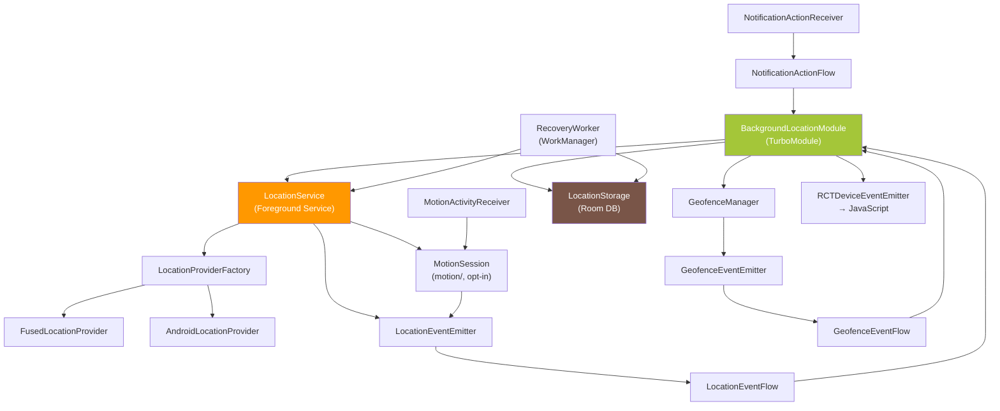
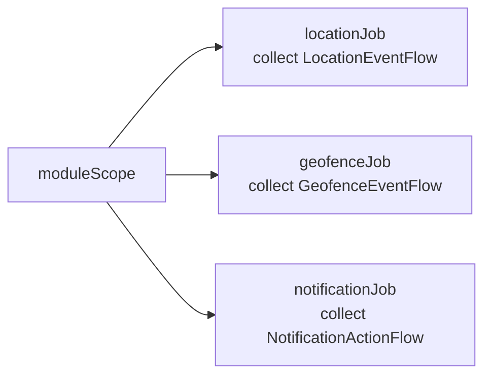
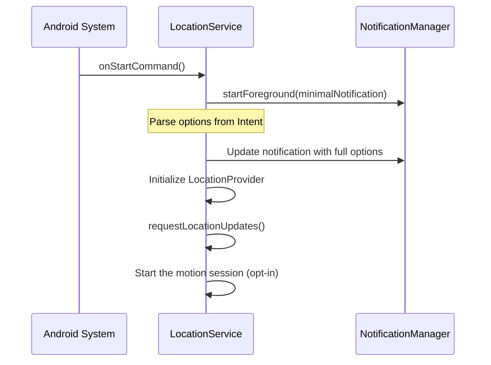
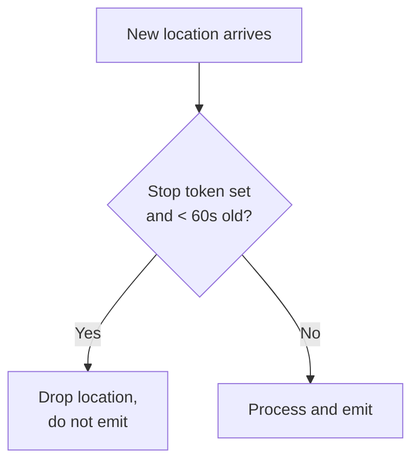
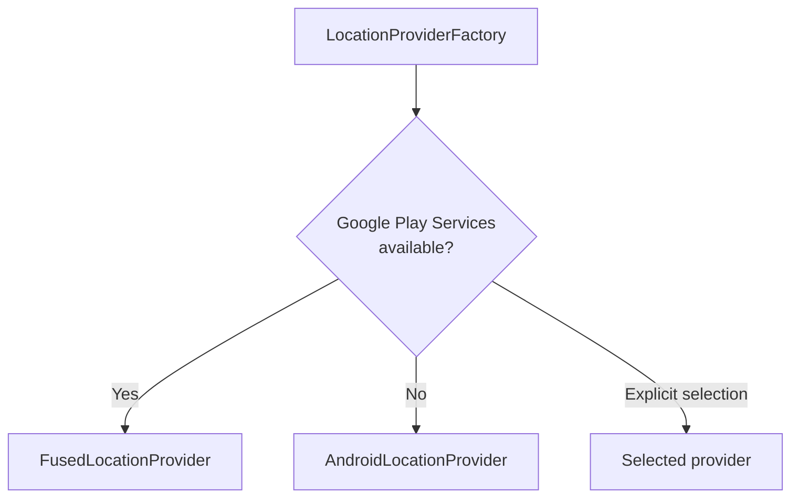
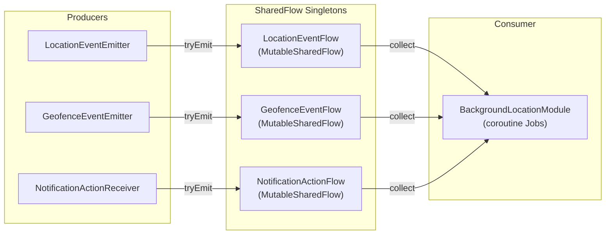
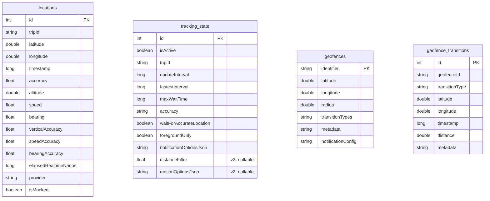
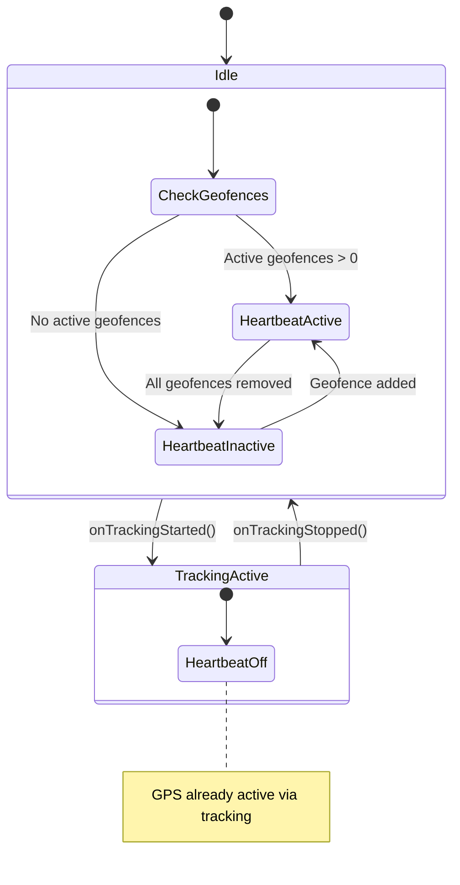
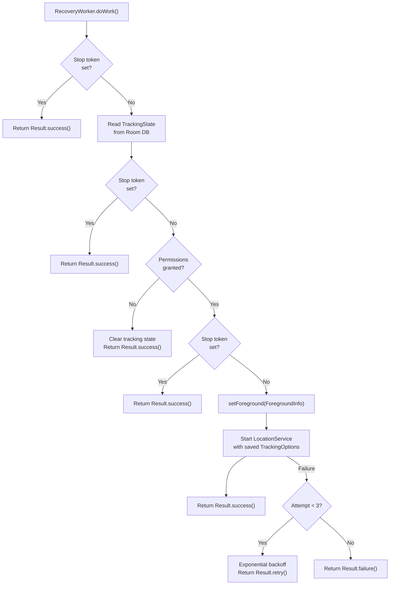

# Android Native Architecture

All Android native code lives under `android/src/main/java/com/backgroundlocation/`. The implementation uses Kotlin with coroutines, Room for persistence, and Google Play Services for location and geofencing.

## Component Overview



## BackgroundLocationModule

The TurboModule entry point. Extends `NativeBackgroundLocationSpec` (Codegen-generated) and implements `LifecycleEventListener`.

### Responsibilities

- **Options parsing** -- Converts `ReadableMap` from JavaScript into the Kotlin `TrackingOptions` data class. `MotionOptions.fromReadableMap()` reads the `motion*` keys and returns `null` (feature off) unless `motionActivityEnabled` is `true`; it never throws.
- **Lifecycle management** -- Listens for host resume/pause/destroy events via `LifecycleEventListener`.
- **Event collection** -- Collects events from three SharedFlow singletons using coroutine Jobs scoped to `moduleScope`.
- **Event forwarding** -- Converts collected events to `WritableMap` and emits via `RCTDeviceEventEmitter`, including `onMotionActivity` for `LocationEvent.MotionActivity` and the `timestamp` of every warning.
- **Recovery orchestration** -- On resume, checks stop token and tracking state, then schedules `RecoveryWorker` (API 31+) or recovers directly.
- **Motion activity methods** -- `checkMotionPermission()` and `requestMotionPermission()` resolve the same status and create no Activity Recognition client; the native module never prompts on Android (the JavaScript layer shows the dialog through `PermissionsAndroid`). `getMotionActivityState()` resolves the JSON snapshot that the service publishes to `MotionStateStore`.

### Coroutine Scoping

```kotlin
private val moduleScope = CoroutineScope(SupervisorJob() + Dispatchers.Main)
```

All event collection runs on `Dispatchers.Main` because `RCTDeviceEventEmitter` must be called from the main thread. `SupervisorJob` ensures that a failure in one collection Job does not cancel the others.

Three collection Jobs run concurrently:



### Stop Sequence

When `stopTracking()` is called:

1. Set stop token in SharedPreferences (synchronous `commit()`).
2. Cancel pending `RecoveryWorker` via WorkManager.
3. Call `removeLocationUpdates()` on the active `LocationService` instance, which also ends its motion session silently. Without an active instance, remove the motion registrations and alarms that a killed process may have left.
4. Save tracking state synchronously via `saveTrackingStateSync()`.
5. Stop the `LocationService`.

## LocationService

A foreground service (`Service`) that manages the GPS pipeline. This is the core component that keeps location tracking alive when the app is in the background.

### Foreground Service Startup

Android 12+ (API 31) requires `startForeground()` within 5-10 seconds of service creation. The service handles this by calling `startForeground()` immediately in `onStartCommand()` with a minimal notification, then updating to the full notification once options are parsed.



> Android 14+ (API 34) requires passing `FOREGROUND_SERVICE_TYPE_LOCATION` to `startForeground()` at runtime.

Every start first ends the previous motion session with `StopReason.RESTART` (a reduced session restores full accuracy and emits `MOTION_LOCATION_RESTORED`), then starts a fresh one after location updates were requested. See [Motion Activity](#motion-activity).

### Restart Loop Detection

SharedPreferences tracks two values: a restart counter and a timestamp. If more than 5 restarts occur within a 1-hour window, the service refuses to start and clears tracking state:

| Condition | Action |
|-----------|--------|
| Counter < 5 within 1 hour | Allow start, increment counter |
| Counter >= 5 within 1 hour | Refuse start, clear tracking state |
| Counter > 0 but timestamp > 1 hour ago | Reset counter, allow start |
| Clean shutdown (`onDestroy`) | Reset counter |

### Stop Token Mechanism

A boolean flag in SharedPreferences with a 60-second TTL. Checked at every location update in `handleLocation()` to suppress late callbacks that may arrive after `stopTracking()`:



### Service Flags and Callbacks

| Method | Behavior |
|--------|----------|
| `onStartCommand()` | Returns `START_REDELIVER_INTENT` for predictable system restart |
| `onTimeout()` (API 35+) | Ends the motion session with `StopReason.RESTART` (restored warning if reduced), emits `SERVICE_TIMEOUT` warning, schedules restart via `Handler`, stops current instance |
| `onTaskRemoved()` | Emits `TASK_REMOVED` warning; service continues (`stopWithTask="false"` in manifest) |
| `onDestroy()` | Cleans up provider, resets restart counter, ends the motion session silently |

### Static Access

`LocationService` exposes a volatile `activeInstance` companion property and a static `isRunning` flag. These allow `BackgroundLocationModule` to directly access the running service for immediate stop and notification updates without service binding.

`activeMotionSession()` returns the active instance's motion session while one with motion enabled exists; `MotionActivityReceiver` routes its deliveries through it. The motion reduction never changes `isRunning`: the service keeps running while reduced, so crash recovery and restart counting are unaffected.

## Location Providers

### Factory Pattern



Both providers implement the `LocationProvider` interface:

```kotlin
interface LocationProvider {
    fun initialize(context: Context)
    fun requestLocationUpdates(
        intervalMs: Long,
        fastestIntervalMs: Long,
        priority: Int,
        distanceFilter: Float,
        callback: LocationUpdateCallback
    )
    fun removeLocationUpdates()
    fun reduceLocationUpdates(profile: ReducedLocationProfile)
    fun restoreLocationUpdates()
    fun isReduced(): Boolean
    fun getLastLocation(callback: (Location?) -> Unit)
    fun isAvailable(): Boolean
    fun cleanup()
}
```

### FusedLocationProvider

Uses Google Play Services `FusedLocationProviderClient`. Features:

- Distance filter via `setMinUpdateDistanceMeters()`.
- Priority mapping from library accuracy enum to `Priority.PRIORITY_*` constants.
- Availability check via `GoogleApiAvailability.getInstance()`.
- Calls `removeLocationUpdates()` at the start of `requestLocationUpdates()` to prevent duplicate callback accumulation.

### AndroidLocationProvider

Fallback for devices without Google Play Services (e.g., Huawei, Amazon). Uses Android's native `LocationManager`:

| Library Accuracy | Android Provider |
|-----------------|-----------------|
| `HIGH_ACCURACY` | `GPS_PROVIDER` |
| `BALANCED_POWER_ACCURACY` | `NETWORK_PROVIDER` |
| `LOW_POWER` | `NETWORK_PROVIDER` |
| `NO_POWER` / `PASSIVE` | `PASSIVE_PROVIDER` |

Also calls `removeLocationUpdates()` before `requestLocationUpdates()` to prevent duplicates.

### Reduced Location Profile

The opt-in motion reduction switches the active request instead of stopping it. `provider/ReducedLocationProfile.kt` defines the profile:

| Field | `ReducedLocationProfile.STATIONARY` |
|-------|-------------------------------------|
| `priority` | `PRIORITY_LOW_POWER` |
| `intervalMs` | 60 s |
| `fastestIntervalMs` | 30 s |
| `minDistanceM` | `0` (no distance filter) |

- `reduceLocationUpdates(profile)` re-registers the same callback with the profile. It is a no-op without an active request or while already reduced.
- `restoreLocationUpdates()` re-applies the parameters of the last `requestLocationUpdates()` call: the trip's own accuracy, interval and distance filter. It is a no-op unless reduced.
- `isReduced()` is true while the reduced profile is active. `LocationService` uses it to ignore location-availability-lost callbacks while reduced, because they describe the keep-alive request, not the trip.
- `FusedLocationProvider` builds a new `LocationRequest` from the profile. Motion detection needs Google Play services, so a reduced trip runs on this provider. `AndroidLocationProvider` implements the same methods through its existing priority mapping (`PRIORITY_LOW_POWER` becomes `PASSIVE_PROVIDER`).

## SharedFlow Event System

The library uses three SharedFlow singletons to decouple event producers (services, receivers) from the consumer (`BackgroundLocationModule`).

### Architecture



### SharedFlow Configuration

All three flows share identical settings:

| Parameter | Value | Rationale |
|-----------|-------|-----------|
| `replay` | 0 | No event replay for late subscribers |
| `extraBufferCapacity` | 64 | Absorb bursts without blocking producers |
| `onBufferOverflow` | `DROP_OLDEST` | Prefer fresh data over completeness |

### Sealed Interfaces

Each flow uses a sealed interface for type-safe event discrimination:

- **`LocationEvent`** -- `Update(tripId, data)`, `Error(tripId, type, message)`, `Warning(tripId, type, message, timestamp)`, `MotionActivity(tripId, activity, confidence, timestamp)`
- **`GeofenceEvent`** -- `Transition(geofenceId, type, coordinates, timestamp, distance, metadata)`
- **`NotificationActionEvent`** -- `ActionClicked(tripId, actionId)`

`Warning.timestamp` defaults to the creation time in milliseconds since epoch, and `BackgroundLocationModule` forwards it with every `onLocationWarning`. `MotionActivity` carries the wire values of the TypeScript `MotionActivityType` and `MotionConfidence` enums and becomes the `onMotionActivity` event.

### Why SharedFlow Over BroadcastReceiver

The original implementation used `LocalBroadcastManager` and `BroadcastReceiver` for event routing. SharedFlow provides:

- **Type safety** -- Sealed interfaces prevent invalid event types at compile time.
- **No serialization overhead** -- Events carry Kotlin objects directly instead of Bundle/Intent extras.
- **Structured concurrency** -- Collection is scoped to `moduleScope` and cancels cleanly.
- **Backpressure handling** -- `DROP_OLDEST` strategy prevents slow consumers from blocking producers.

## Motion Activity

The opt-in motion activity feature lives in the `motion/` package. `LocationService` owns one `MotionSession`, and nothing in the package runs unless a trip enables `motionActivity`. The [Motion Activity guide](../guides/motion-activity.md) describes the public behaviour.

### Components

| File | Role |
|------|------|
| `MotionOptions.kt` | Native options (`TrackingOptions.motion`; `null` means off). Applies the defaults and clamps again, and reads the TurboModule keys (`fromReadableMap`) and the stored JSON (`fromJsonString`, which returns `null` for malformed JSON) |
| `MotionTypes.kt` | Wire enums, the `onMotionActivity` event, the receiver deliveries (`MotionDelivery`), the exact warning messages (`MotionWarnings`) and the state snapshot (`MotionStateSnapshot`) |
| `MotionClassifier.kt` | Pure mapping of Activity Recognition samples and transitions to activity, confidence and gate input, including vehicle evidence |
| `MotionGate.kt` | Pure reduction decision function; see [Reduction Gate](./data-flow.md#reduction-gate) |
| `MotionPermissions.kt` | The permission that gates Activity Recognition on each API level, the `checkMotionPermission()` status, and `AndroidMotionPlatform` (Play services and permission checks, main-thread assertion in debug builds) |
| `MotionPendingIntents.kt` | The broadcast PendingIntents, the stale-registration cleanup, `GmsMotionRecognitionClient` (the Play services client) and `AlarmMotionTimers` (the gate timers) |
| `MotionActivityReceiver.kt` | Manifest-registered receiver for samples, transitions and timer alarms |
| `MotionSession.kt` | One session per service start: checks, registrations, de-duplicated events, the gate and its effects, warnings and the published state |

### Session Lifecycle

- **Main thread only** -- `MotionSession` runs on the main thread, which `assertMainThread()` checks in debug builds. Creating it creates no Activity Recognition client.
- **Start** -- `onStartCommand()` calls `motionSession.start(tripId, options)` after location updates were requested. With motion on, the session checks Google Play services, then the permission, then creates `GmsMotionRecognitionClient` and registers periodic samples (every `sampleInterval`) and transitions. When the trip allows a reduction, it starts the gate, cooldown first. Any failure becomes one detection warning and full-accuracy tracking; nothing throws.
- **Feature off** -- `start()` only removes stale registrations. `MotionPendingIntents.removeStale()` looks the PendingIntents up with `FLAG_NO_CREATE`, so the lookups create nothing. Only when a registration left by an earlier session exists does it create an Activity Recognition client, to remove that registration. The same cleanup runs on restart-loop detection, when `stopTracking()` finds no active service instance, and when the receiver gets a delivery without an active session (or after the stop token is set).
- **Restart** -- Every new start, and the Android 15+ `onTimeout()` restart, first ends the previous session with `StopReason.RESTART`: a reduced session restores full accuracy and emits `MOTION_LOCATION_RESTORED` ("Tracking restarted; ...").
- **Stop** -- `stopTracking()` and `onDestroy()` end the session with `StopReason.STOP`: both registrations are removed, every alarm is cancelled, the OFF state is published, and no warning is emitted.

### Registrations and Timers

- Activity Recognition results arrive as explicit broadcasts to `MotionActivityReceiver`. These PendingIntents are mutable on Android 12+ because Play services writes the result extras into them. The session registers seven transitions: STILL enter and exit, IN_VEHICLE enter and exit, and ON_BICYCLE, WALKING and RUNNING enter.
- The gate timers (dwell, cooldown, maximum reduced period, 120-second probe) are inexact `AlarmManager.setAndAllowWhileIdle` alarms on `ELAPSED_REALTIME_WAKEUP`, with immutable PendingIntents and one request code per timer kind. No exact-alarm permission is required or added.
- The system can deliver these alarms later than configured. Outside Doze and battery saver, an inexact alarm can come up to about 75% of its duration late: with the defaults, the stationary delay can take up to about 8.75 minutes, the cooldown 17.5, the maximum reduced period 52.5 and the probe 3.5. Android 12 and later deliver an inexact alarm within one hour of its time unless battery saver or Doze is active, and in Doze allow-while-idle alarms fire at most once every 9 minutes per app. The classifier (transitions and samples) remains the primary restore path.
- `MotionTimers.start()` reports whether the alarm was armed. When arming any gate timer fails, the session handles it as a lost detection: the gate restores full accuracy (with `MOTION_LOCATION_RESTORED` first if it was reduced), detection stops for the session (`UNAVAILABLE`), and the session emits `MOTION_ACTIVITY_UNAVAILABLE` with `Motion activity could not start (AlarmManager). Location tracking continues at full accuracy.`
- Every arming carries a token, and the session ignores a delivery whose token is not the armed one, so late alarms of a cancelled or replaced timer do nothing.

### Library Manifest

```xml
<receiver
  android:name=".motion.MotionActivityReceiver"
  android:enabled="true"
  android:exported="false" />
```

The receiver is non-exported and has no intent filter, and the library manifest declares no activity-recognition permission. The app declares the permissions itself; see [Android setup](../guides/motion-activity.md#android-setup).

### Fixes, Notification and Warnings

- **Fix classification** -- `LocationService` asks `motionSession.classifyFix()` before the location processor runs. A keep-alive fix (taken while reduced, or older than the last full-accuracy restore) only feeds the displacement check and is never stored or emitted. A full-accuracy fix reaches the gate only after it was recorded, with its accuracy plus the trip's `distanceFilter` as the accuracy the gate uses. See [Location Fixes While Reduced](./data-flow.md#location-fixes-while-reduced).
- **Notification text** -- While reduced, the content text of the foreground notification switches to `notificationText` (default `'Location updates reduced while stationary'`) and the notification is re-posted. Title, icon, actions and channel stay unchanged, and the base text returns on restore.
- **Warnings** -- The session emits through `LocationEventEmitter.emitWarning()`, so motion warnings take the same path, with the same `timestamp`, as the other warnings. A session sends at most one detection warning, reduction warnings only for visible transitions, and nothing after a stop request or once the stop token is set.
- **State** -- After every change the session publishes a snapshot to `MotionStateStore`, a `@Volatile` JSON string that `getMotionActivityState()` resolves directly.

### Isolation

- `LocationService.isRunning` is unchanged by the reduction: the foreground service keeps running, so crash recovery and restart counting are unaffected.
- No call path leads from `motion/` to `GeofenceManager`, and the reduction does not touch geofence registrations. The geofence heartbeat runs only when tracking is not active, so it stays off while a trip is reduced. With only the low-power request alive, geofence transitions can be reported later than with full-accuracy tracking, until movement restores full accuracy.

## Room Database

### Schema

Room schema version 2. The upgrade from version 1 keeps the data: `MIGRATION_1_2` is additive and adds two nullable columns to `tracking_state`, `distanceFilter` (REAL) and `motionOptionsJson` (TEXT), so every existing row (locations, tracking state, geofences, geofence transitions) is preserved. See [Migration Policy](#migration-policy).



### Migration Policy

```kotlin
internal val MIGRATION_1_2 = object : Migration(1, 2) {
  override fun migrate(db: SupportSQLiteDatabase) {
    db.execSQL("ALTER TABLE `tracking_state` ADD COLUMN `distanceFilter` REAL")
    db.execSQL("ALTER TABLE `tracking_state` ADD COLUMN `motionOptionsJson` TEXT")
  }
}

internal fun applyMigrationPolicy(
  builder: RoomDatabase.Builder<LocationDatabase>
): RoomDatabase.Builder<LocationDatabase> =
  builder
    .addMigrations(MIGRATION_1_2)
    .fallbackToDestructiveMigration()
```

- Registered migrations always win, so upgrades keep the data.
- `fallbackToDestructiveMigration()` remains only for paths with no registered migration: a downgrade or an unknown version.
- A migration that left a mismatched schema would fail when the database opens; the fallback does not cover that case. `LocationDatabaseMigrationTest` (Robolectric, run by `yarn test:android`) guards it: it migrates a version 1 database with rows in all four tables and validates the version 2 schema with every row intact.
- KSP exports every schema to `android/schemas/com.backgroundlocation.database.LocationDatabase/` (`1.json` unchanged, `2.json` added). The migration test reads them as test assets, and CI fails when the export is not committed.
- The version 2 columns stay last in `TrackingStateEntity`, in this order, so the generated `CREATE TABLE` matches the `ALTER TABLE` statements.

### LocationStorage

Thread-safe persistence layer built on Room. Key design:

- **Batched writes** -- `ConcurrentLinkedQueue` buffer, flushed at 10 items or every 5 seconds.
- **Force flush** -- `forceFlush()` drains buffer before reads to guarantee consistency.
- **Tracking state** -- Single-row table (`id = 1`). The `TrackingOptions` fields are columns, with the notification and motion options as JSON strings. Crash recovery restores `distanceFilter` (recovered sessions previously ran without it) and the motion options; a malformed stored motion value turns motion off for that session.
- **Synchronous save** -- `saveTrackingStateSync()` suspend function for the stop sequence to prevent race conditions.
- **Flush before reducing** -- `flushAsync()` starts a flush without waiting for it. The motion gate calls it before it reduces location updates, so buffered locations reach storage first.
- **Coroutine scope** -- `SupervisorJob() + Dispatchers.IO` for all database operations.
- **Cleanup** -- `cleanup()` cancels the batch timer, flushes pending writes, and cancels the scope.

## GeofenceManager

Manages the full geofence lifecycle: registration, removal, persistence, recovery, and location heartbeat.

### Tracking Coordination



When tracking is active, the GPS pipeline is already warm, so the heartbeat is unnecessary. When tracking stops but geofences remain registered, `GeofenceManager` starts a low-frequency location heartbeat to keep passive geofence detection working.

### Hooks

| Hook | When Called | Action |
|------|-----------|--------|
| `onTrackingStarted()` | `LocationService` begins tracking | Stop heartbeat (GPS already active) |
| `onTrackingStopped()` | `LocationService` stops tracking | Start heartbeat if geofences exist |

## RecoveryWorker

A `CoroutineWorker` scheduled via WorkManager for crash recovery on Android 12+ (API 31+). Older APIs recover directly in `BackgroundLocationModule.onHostResume()`.

### Recovery Pipeline



The stop token is checked at three separate points (before state read, after state read, before service start) to handle race conditions where `stopTracking()` is called while recovery is in progress.

The saved `TrackingOptions` include `distanceFilter` and the motion options (Room schema version 2). The recovered service starts a fresh motion session through the normal path: no prompt, full accuracy, cooldown first.

> `RecoveryWorker` uses `setForeground(ForegroundInfo(...))` to comply with Android 12+ background start restrictions. This creates a short-lived system foreground service specifically for the recovery operation.

### Retry Strategy

| Attempt | Backoff |
|---------|---------|
| 1 | Exponential (default ~30s) |
| 2 | Exponential (~60s) |
| 3 | Final attempt |
| > 3 | `Result.failure()`, no more retries |

## Notification System

### NotificationDefaults

Resolves notification icons and colors using a four-level priority chain:

1. **Runtime** -- Values passed in `TrackingOptions` at start time.
2. **Manifest metadata** -- `<meta-data>` keys in AndroidManifest.xml (`com.backgroundlocation.default_notification_icon`, etc.).
3. **Conventional drawables** -- Resource names `bg_location_notification_icon` and `bg_location_notification_large_icon`.
4. **System default** -- `android.R.drawable.ic_menu_mylocation`.

Values are cached after first resolution.

### NotificationActionReceiver

A manifest-registered `BroadcastReceiver` for notification button taps. When the user presses a notification action button:

1. Android delivers a `PendingIntent` broadcast to `NotificationActionReceiver`.
2. The receiver extracts the action ID and trip ID from the intent.
3. It emits an `ActionClicked` event directly to `NotificationActionFlow`.
4. `BackgroundLocationModule` collects the event and forwards it to JavaScript as `onNotificationAction`.

### Dynamic Updates

`updateNotification(title, text)` accesses `LocationService.activeInstance` directly to update the notification content at runtime. Changes are transient -- they are not persisted to the database and will revert to the original values on service restart. While location updates are reduced (opt-in motion activity), the title changes at once and the new text is stored and shown when full accuracy is restored.

## Permission Checks

`BackgroundLocationModule` checks permissions based on the tracking mode:

| Mode | Permissions Checked |
|------|-------------------|
| Background tracking | `ACCESS_FINE_LOCATION` + `ACCESS_BACKGROUND_LOCATION` (API 29+) + `POST_NOTIFICATIONS` (API 33+) |
| Foreground-only | `ACCESS_FINE_LOCATION` + `POST_NOTIFICATIONS` (API 33+) |

When `foregroundOnly: true`, `ACCESS_BACKGROUND_LOCATION` is skipped entirely.

> **Note:** `startTracking()` never prompts for the motion permission. When a trip enables `motionActivity`, the motion session checks `android.permission.ACTIVITY_RECOGNITION` (API 29+) or `com.google.android.gms.permission.ACTIVITY_RECOGNITION` (API 28 and lower). If it is missing, the session emits `MOTION_PERMISSION_NOT_GRANTED` and tracking continues at full accuracy. `checkMotionPermission()` never reports `UNDETERMINED` on Android.

## Next Steps

- [iOS Native Architecture](./ios-native.md) -- The iOS counterpart using CLLocationManager and Core Data.
- [Data Flow](./data-flow.md) -- Cross-platform data flow comparison.
- [Motion Activity](../guides/motion-activity.md) -- Setup and behaviour of the opt-in motion activity feature.
