# Data Flow

This document traces the complete data flow for location tracking, geofencing and the opt-in motion activity feature -- from the React hook layer through the TurboModule bridge, into native services, and back to JavaScript via event emitters.

## High-Level Flow

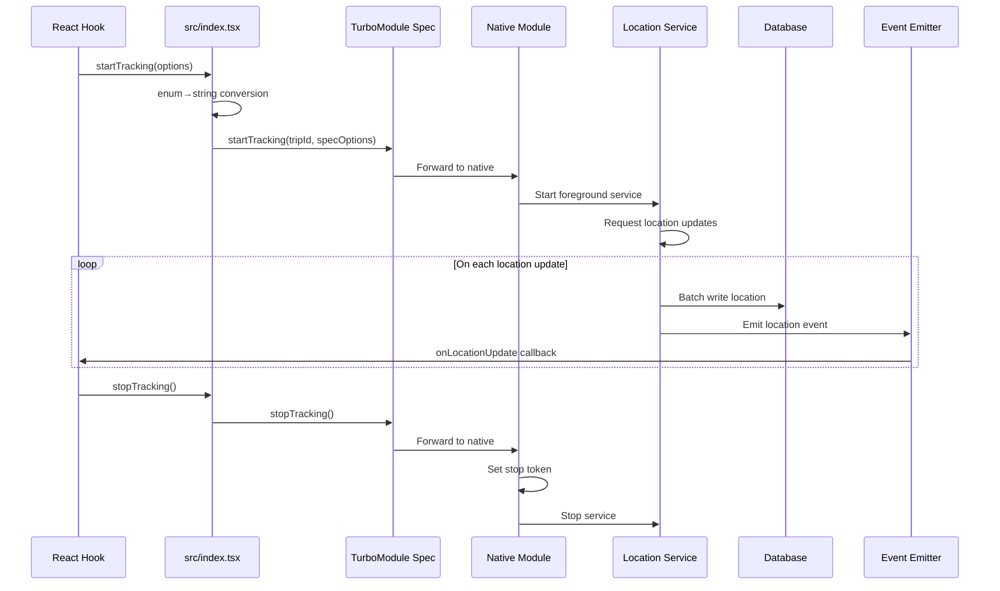

## Start Tracking Flow

When `startTracking()` is called, data crosses three boundaries before reaching the location provider.

### Step 1: TypeScript API (src/index.tsx)

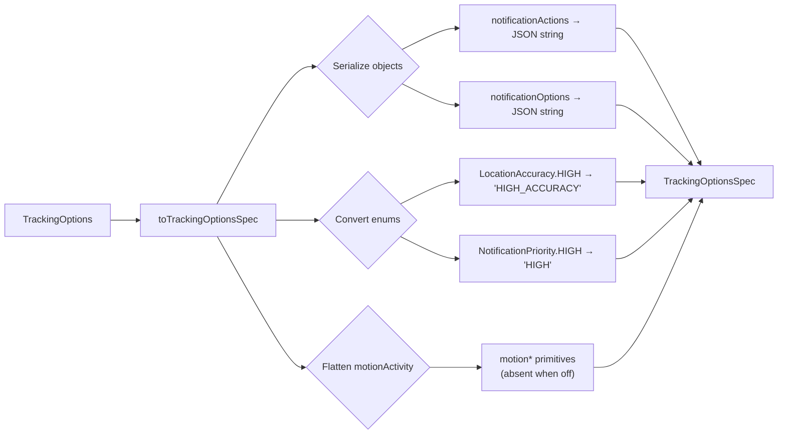

The `toTrackingOptionsSpec()` utility in `src/utils/trackingOptionsMapper.ts` handles three conversions that Codegen cannot:

1. **Enum-to-string** -- `LocationAccuracy` and `NotificationPriority` enum values become plain strings.
2. **Object-to-JSON** -- `notificationActions` (capped at 3 items) and `notificationOptions` are serialized to JSON strings.
3. **Motion flattening** -- `motionActivity` becomes optional `motion*` primitives through `toMotionSpecFields()` in `src/utils/motionOptionsMapper.ts`. Out-of-range numbers are clamped, malformed values never cross the bridge, and none of the keys is present when the feature is off.

### Step 2: TurboModule Bridge

The `TrackingOptionsSpec` interface crosses the bridge with all values in Codegen-compatible types (strings, numbers, booleans). The native side receives a `ReadableMap` (Android) or `NSDictionary` (iOS) and reconstructs the typed options.

### Step 3: Native Service Initialization

- **Android**: `BackgroundLocationModule` parses the `ReadableMap` into a Kotlin `TrackingOptions` data class, saves tracking state to Room DB, and starts `LocationService` as a foreground service. `MotionOptions.fromReadableMap()` reads the `motion*` keys; the result is `null` (feature off) unless `motionActivityEnabled` is `true`.
- **iOS**: `BackgroundLocation.mm` forwards to `LocationManagerWrapper.swift`, which configures `CLLocationManager` with the mapped accuracy, distance filter, and background mode settings. The bridge transports the five `motion*` keys iOS uses (the sampling interval and the notification text are Android-only), and `TrackingOptions.motionOptions` applies the motion defaults and clamps again.

## Location Update Flow

Once tracking is active, location updates flow from the OS through the native layer and back to JavaScript.

### Android Event Pipeline

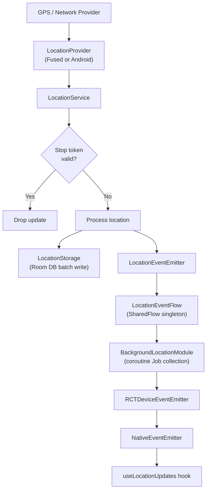

Android uses **SharedFlow singletons** to decouple event producers from consumers:

| SharedFlow | Sealed Interface | Producer | Consumer |
|------------|-----------------|----------|----------|
| `LocationEventFlow` | `LocationEvent` (Update, Error, Warning, MotionActivity) | `LocationEventEmitter` | `BackgroundLocationModule` |
| `GeofenceEventFlow` | `GeofenceEvent` (Transition) | `GeofenceEventEmitter` | `BackgroundLocationModule` |
| `NotificationActionFlow` | `NotificationActionEvent` (ActionClicked) | `NotificationActionReceiver` | `BackgroundLocationModule` |

All three flows share the same configuration: `replay = 0`, `extraBufferCapacity = 64`, `onBufferOverflow = DROP_OLDEST`. The non-suspending `tryEmit()` API ensures producers never block.

`BackgroundLocationModule` collects from all three flows using coroutine Jobs scoped to `moduleScope` (SupervisorJob + Dispatchers.Main). Each collected event is forwarded to JavaScript via `RCTDeviceEventEmitter`.

### iOS Event Pipeline

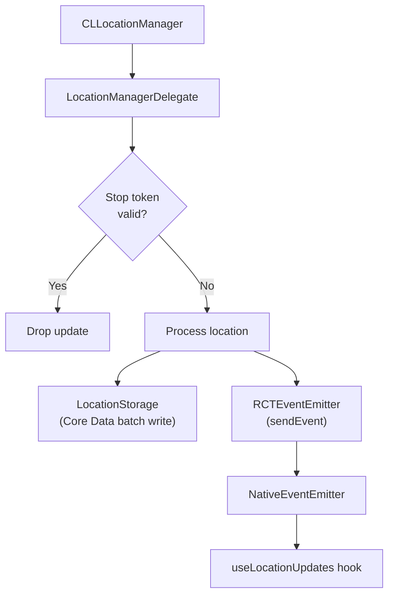

iOS uses **RCTEventEmitter** directly. `LocationManagerDelegate` processes each `CLLocation` from the `didUpdateLocations:` callback, writes to Core Data, and emits to JavaScript via `sendEvent(withName:body:)`. There is no intermediate flow layer -- the delegate bridges directly to the React Native event system.

### Platform Comparison

| Aspect | Android | iOS |
|--------|---------|-----|
| Event decoupling | SharedFlow singletons (3 flows) | Direct delegate-to-emitter |
| Buffer strategy | 64-element ring buffer, DROP_OLDEST | No buffer (immediate emit) |
| Thread model | Coroutine collection on Main dispatcher | Main thread delegate callbacks |
| Producer API | Non-suspending `tryEmit()` | Synchronous `sendEvent()` |
| Consumer lifecycle | Coroutine Jobs tied to `moduleScope` | RCTEventEmitter managed by React Native |
| Motion events (opt-in) | `LocationEvent.MotionActivity` on `LocationEventFlow`, produced on the main thread | `onMotionActivity` closure, called on the wrapper's serial queue |

## Event Payload Format

Both platforms emit identical event payloads to JavaScript:

### onLocationUpdate

```typescript
{
  tripId: string;
  latitude: number;
  longitude: number;
  timestamp: number;
  accuracy?: number;
  altitude?: number;
  speed?: number;
  bearing?: number;
  verticalAccuracy?: number;
  speedAccuracy?: number;
  bearingAccuracy?: number;
  elapsedRealtimeNanos?: number;
  provider?: string;
  isMocked?: boolean;
}
```

### onLocationError

```typescript
{
  tripId: string;
  type: 'PERMISSION_REVOKED' | 'PROVIDER_ERROR';
  message: string;
}
```

### onLocationWarning

```typescript
{
  tripId: string;
  type: LocationWarningType;
  message: string;
  timestamp: number; // ms since epoch, taken when the native layer emits the warning
}
```

`LocationWarningType` has 11 members: `SERVICE_TIMEOUT`, `TASK_REMOVED` and `LOCATION_UNAVAILABLE`; four warnings iOS already sent before 1.2.0 (`LOCATION_UPDATES_PAUSED`, `LOCATION_UPDATES_RESUMED`, `PERMISSION_REVOKED`, `PERMISSION_DOWNGRADED`); and the four motion warnings (`MOTION_LOCATION_REDUCED`, `MOTION_LOCATION_RESTORED`, `MOTION_ACTIVITY_UNAVAILABLE`, `MOTION_PERMISSION_NOT_GRANTED`). Both platforms send `timestamp` with every warning, old and new; before 1.2.0 the field was declared but never sent. Motion warnings always carry the active, non-empty `tripId`.

> **Note:** The wider union can break an exhaustive `switch` (a `never` check) at compile time. Keep a `default` branch.

### onNotificationAction

```typescript
{
  tripId: string;
  actionId: string;
}
```

### onMotionActivity

Emitted only while a trip started with `motionActivity` enabled is active, de-duplicated on `(activity, confidence)` per session:

```typescript
{
  tripId: string;
  activity: MotionActivityType; // STATIONARY | WALKING | RUNNING | CYCLING | AUTOMOTIVE | UNKNOWN
  confidence: MotionConfidence; // LOW | MEDIUM | HIGH
  timestamp: number; // time of the detection, ms since epoch
}
```

## Storage Flow

### Write Path

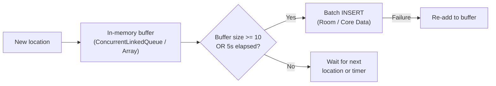

Both platforms use the same batching strategy:

- Locations are buffered in memory.
- Flush triggers when the buffer reaches **10 items** or a **5-second timer** fires.
- On flush failure, items are re-added to the buffer for retry.

### Read Path

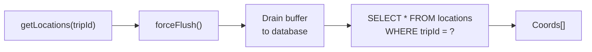

Every read operation calls `forceFlush()` first to drain pending writes, guaranteeing that the returned data includes the most recent buffered locations.

## Geofencing Data Flow

### Registration

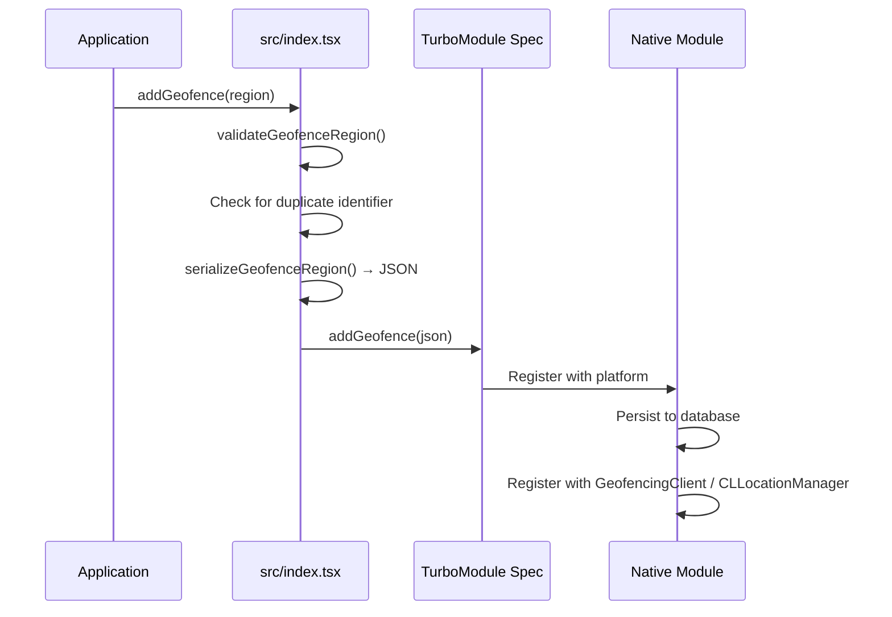

Geofence regions go through three transformations before reaching the platform:

1. **Validation** -- `validateGeofenceRegion()` checks identifier, radius, coordinates, and metadata.
2. **Duplicate check** -- Queries active geofences to prevent duplicate identifiers.
3. **Serialization** -- `serializeGeofenceRegion()` converts the typed `GeofenceRegion` to a JSON string for the bridge.

### Transition Events

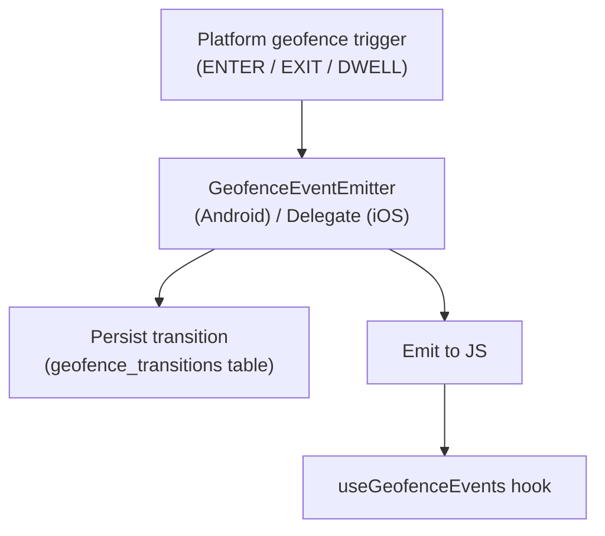

Transition events are both persisted (for later retrieval via `getGeofenceTransitions()`) and emitted in real-time to JavaScript.

## Motion Activity Flow

Everything in this section runs only for a trip started with `motionActivity` enabled. The [Motion Activity guide](../guides/motion-activity.md) describes the public behaviour.

### Android Motion Pipeline

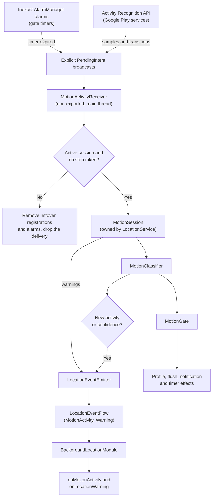

1. Play services delivers periodic samples (every `sampleInterval`) and the registered transitions as explicit broadcasts to `MotionActivityReceiver`, which the library manifest declares non-exported, with no intent filter. The gate timers arrive the same way, from inexact `AlarmManager.setAndAllowWhileIdle` alarms. Each alarm carries the token of its arming, so a late delivery of a cancelled or replaced timer is ignored.
2. The receiver runs on the main thread. Without an active motion session, or once the stop token is set, it removes leftover registrations and alarms and drops the delivery.
3. `MotionSession` (one per `LocationService` instance, main thread only) maps each result through `MotionClassifier`. A new `(activity, confidence)` pair becomes an `onMotionActivity` event: the first event of a session is always emitted, and transition EXIT events never are. When the trip allows a reduction, the same result feeds `MotionGate`, and the service runs the effects it returns: location profile, storage flush, notification text and timers.
4. Events and warnings take the existing path: `LocationEventEmitter` → `LocationEventFlow` (`LocationEvent.MotionActivity`, `LocationEvent.Warning`) → `BackgroundLocationModule` → `RCTDeviceEventEmitter`. A `LocationEvent.Warning` takes its `timestamp` when it is created, and the module forwards it.

### iOS Motion Pipeline

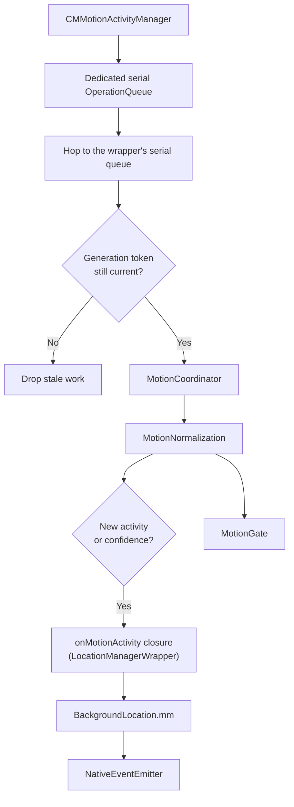

CoreMotion delivers every update on a dedicated serial `OperationQueue`. The handler copies the reading into plain values and hops to the wrapper's serial queue, where `MotionCoordinator` does all its work. The coordinator bumps a generation token on every session start and stop, so readings, timers and app-active notifications that belong to an earlier session drop their work. Motion warnings take the existing `onLocationWarning` closure; one wrapper helper builds the payload of every warning, `timestamp` included.

### Reduction Gate

Both platforms run the same pure decision function (`motion/MotionGate.kt` and `ios/Motion/MotionGate.swift`). It owns no clock, timer or platform object: the session feeds it classifier results, classified location fixes, timer expirations and lifecycle events, and runs the effects it returns. A session has a gate only when `reduceWhenStationary` was requested, detection started, and the trip is neither `foregroundOnly` nor running at `PASSIVE` or `NO_POWER` accuracy.

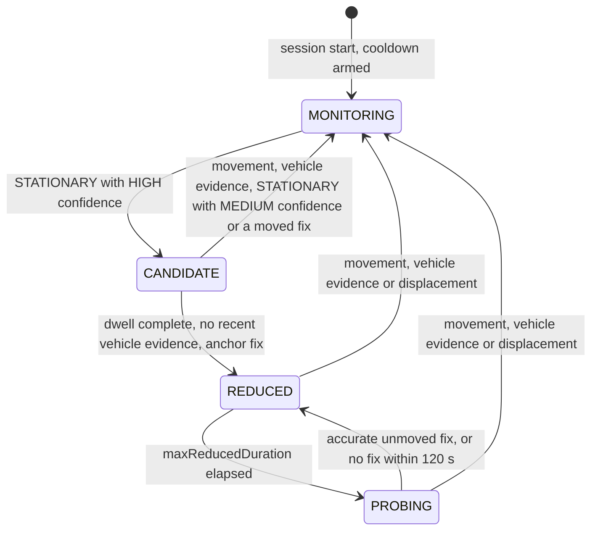

- Every session starts in `MONITORING` with the cooldown armed, as if a vehicle had just been seen, and every vehicle evidence restarts the cooldown. The state is never persisted.
- `MONITORING` and `CANDIDATE` are reported to JavaScript as `MONITORING`; `REDUCED` and `PROBING` as `REDUCED`.
- Reducing flushes buffered locations to storage, applies the reduced profile, emits `MOTION_LOCATION_REDUCED` and starts the `maxReducedDuration` timer. Every restore returns to the trip's own profile and emits `MOTION_LOCATION_RESTORED`; a probe that goes back to `REDUCED` emits nothing.
- When detection is lost while reduced (for example, the permission is revoked), `MOTION_LOCATION_RESTORED` comes first and the cause warning second.
- The four timers are the dwell (`stationaryDelay`), the cooldown (`automotiveCooldown`), the maximum reduced period (`maxReducedDuration`) and the 120-second probe. On Android they are inexact `setAndAllowWhileIdle` alarms, which can fire up to about 75% of their duration later than configured outside Doze and battery saver, and later still in Doze (allow-while-idle alarms fire at most once every 9 minutes per app). An Android timer that cannot be armed ends detection for the session, like a lost registration: full accuracy and `MOTION_ACTIVITY_UNAVAILABLE` (`Motion activity could not start (AlarmManager). ...`). On iOS they are `DispatchSourceTimer`s on the library's serial queue: the maximum-reduced-period and probe timers follow wall-clock time, while the dwell and cooldown timers do not advance during device sleep, which can only postpone a reduction.

### Location Fixes While Reduced

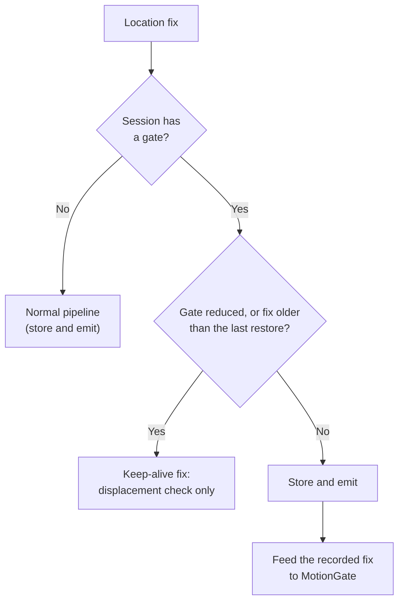

- Keep-alive fixes are never stored or emitted; they only feed the displacement check. A fix whose error circle no longer overlaps the anchor's (distance greater than max(100 m, sum of both accuracies)) restores full accuracy. On Android they bypass the location processor; on iOS they bypass the 10-second age filter.
- A full-accuracy fix enters the gate with its horizontal accuracy plus the distance filter the trip runs with (on iOS, the accuracy-based default when `distanceFilter` is not set), because with a distance filter the last recorded fix can be up to that far from where the device stopped. Keep-alive fixes keep their own accuracy. With a 150 m distance filter, a 10 m anchor and a keep-alive fix of 30 m accuracy, the threshold is 190 m.
- A full-accuracy fix reaches the gate only after it was recorded. The anchor of a dwell is the last recorded full-accuracy fix.
- After a restore, fixes older than the restore moment are discarded as keep-alive.
- While reduced, location-unavailable reports describe the keep-alive request, not the trip, so they are not emitted: on Android the location-availability-lost callbacks (`LOCATION_UNAVAILABLE`), on iOS `didFailWithError:` other than `.denied`. During the probe the full profile runs and these reports reach JavaScript normally.

**Probe.** Every `maxReducedDuration` the gate applies the full profile for up to 120 seconds. A fix with accuracy 100 m or better that has not moved is recorded (the forced fix) and the reduction resumes silently. A moved fix restores full accuracy (displacement), movement restores it (motion), and no fix within 120 seconds returns to the reduced profile silently. JavaScript keeps seeing `REDUCED` during the probe. Before each probe the timer re-checks the motion permission; a revoked permission ends detection instead. On iOS the dwell and cooldown timers re-check it as well when they fire while a stationary period is being confirmed.

### Motion State Snapshot

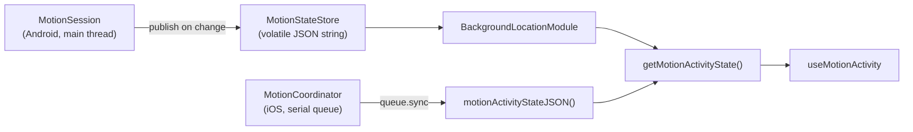

`getMotionActivityState()` reads a JSON snapshot of the session: `tripId`, `detection`, `reduction` and `lastActivity`. On Android the service publishes it to a `@Volatile` field (`MotionStateStore`) on every change, and the module resolves that string without touching the session. On iOS the wrapper reads it from `MotionCoordinator` with `queue.sync`. Without a motion session both return the OFF state, and the JavaScript layer also falls back to the OFF state when the string cannot be parsed. [`useMotionActivity`](../api-reference/hooks/useMotionActivity.md) hydrates from it on mount, when `tripId` changes, when the app becomes active, on every `MOTION_*` warning, and on the first event of a session that it has not yet read as running. A stop publishes the OFF state without an event or a warning, so apps call the hook's `refresh()` after `stopTracking()`.

## Stop Tracking Flow

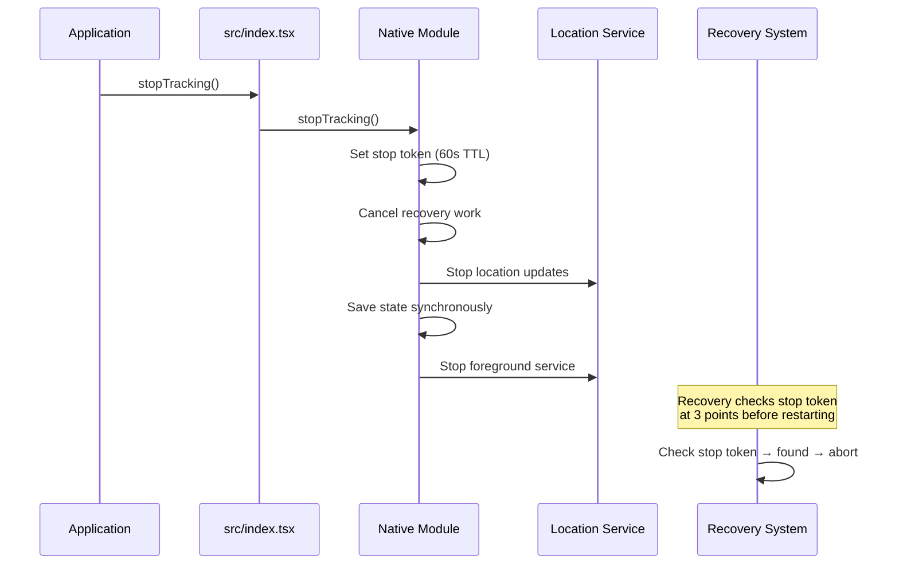

The stop token is the critical mechanism that prevents the recovery system from restarting a service that was intentionally stopped. It is set synchronously (`commit()` on Android, synchronous UserDefaults write on iOS) during `stopTracking()` and checked at three points in the recovery pipeline.

An explicit stop also ends the motion session silently: the Activity Recognition registrations (Android) or the CoreMotion updates (iOS) are removed, every gate timer is cancelled, and no motion warning is emitted after `stopTracking()`.

## Recovery Flow

### Android (WorkManager)

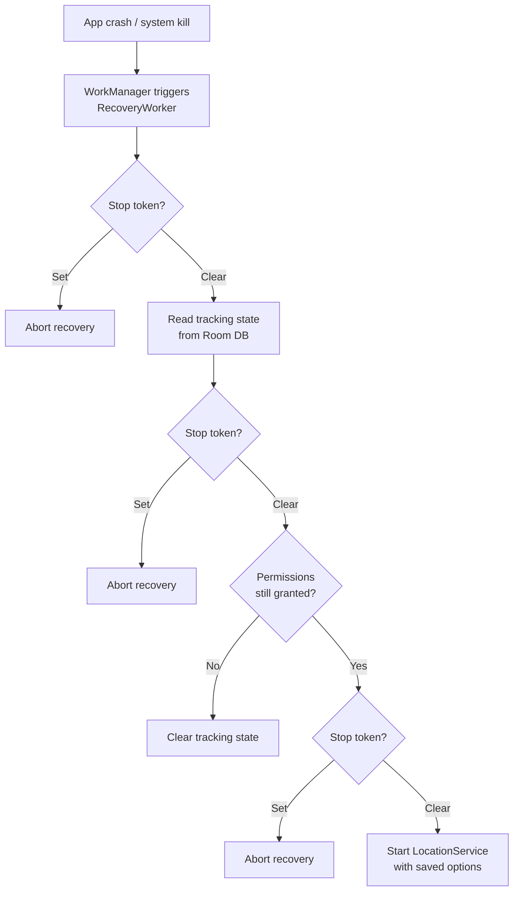

The saved options include `distanceFilter` and the motion options (Room schema v2). A malformed stored motion value turns motion off for that session.

### iOS (Significant Location Monitoring)

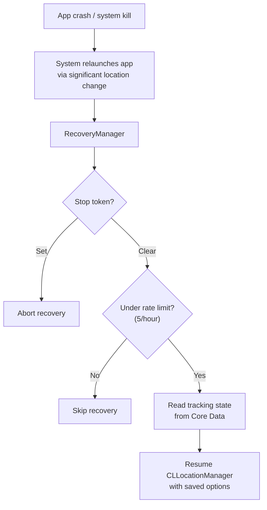

Options without a Core Data attribute (`activityType`, `waitForAccurateLocation` and the motion keys) are read from `UserDefaults` (`bg_location_tracking_options_ext`). On both platforms the recovered trip starts a fresh motion session through the normal path: it never prompts, and it starts at full accuracy with the cooldown first.

## Hook Data Flow

### useLocationUpdates

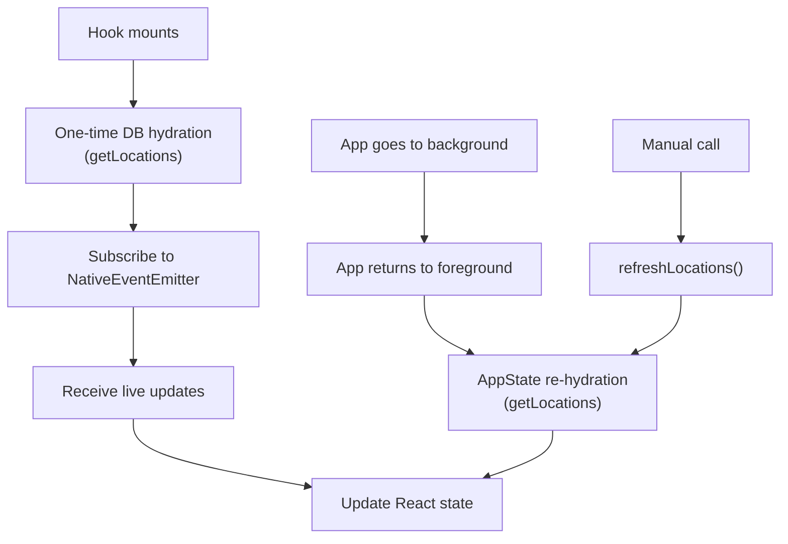

The hook uses three data sources:

1. **Mount hydration** -- One-time `getLocations()` call on mount to load persisted data.
2. **Live events** -- `NativeEventEmitter` subscription for real-time updates.
3. **Foreground re-hydration** -- `AppState` listener triggers `getLocations()` when the app returns from background, catching any updates that arrived while the JS bridge was inactive.

## Next Steps

- [Android Native Architecture](./android-native.md) -- Deep dive into SharedFlow, coroutines, and the foreground service.
- [iOS Native Architecture](./ios-native.md) -- Deep dive into CLLocationManager, Core Data, and the permission escalation flow.
- [Motion Activity](../guides/motion-activity.md) -- Setup and behaviour of the opt-in motion activity feature.
