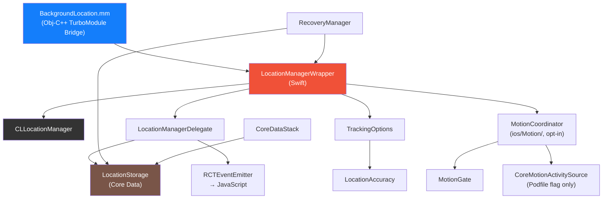
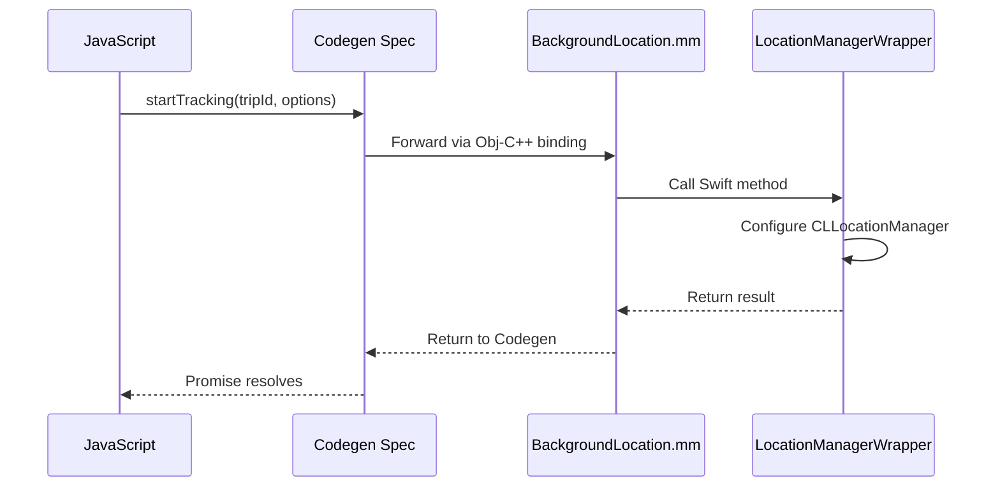
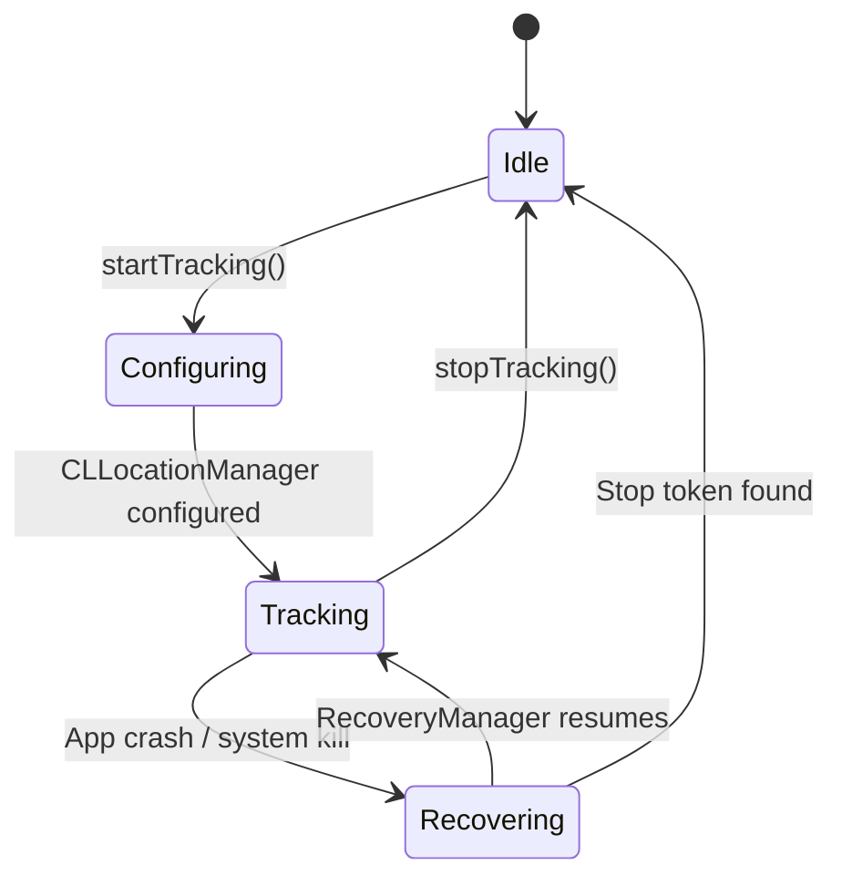
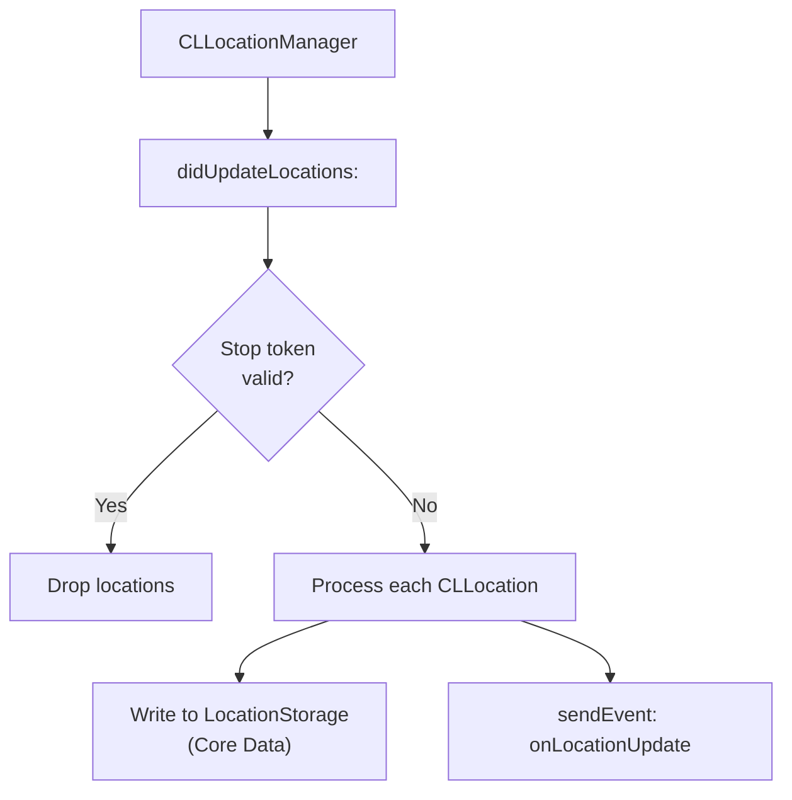
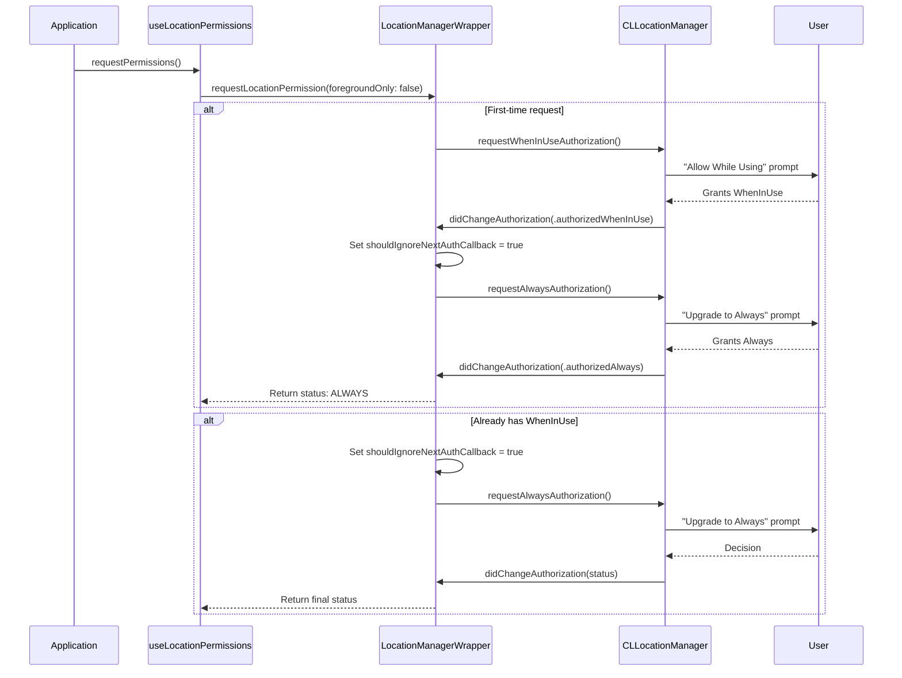
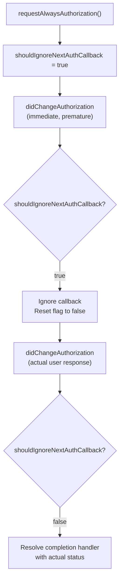
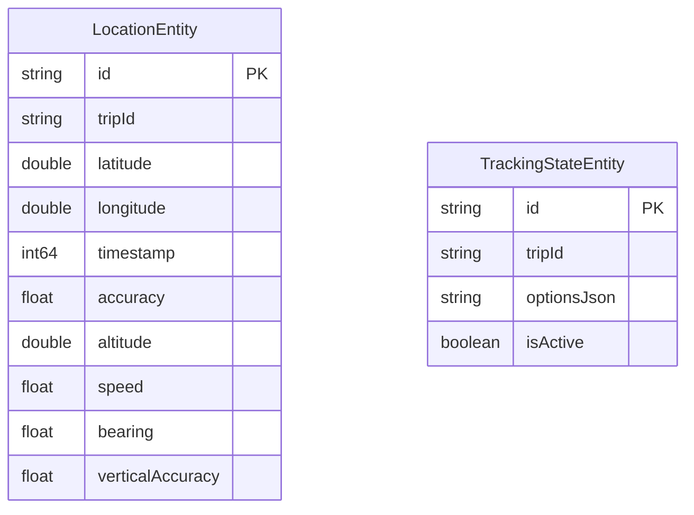
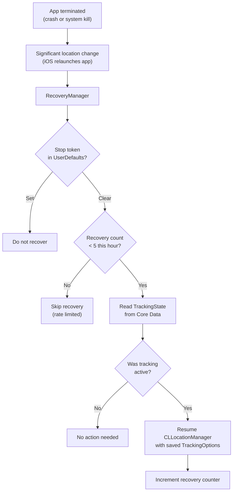
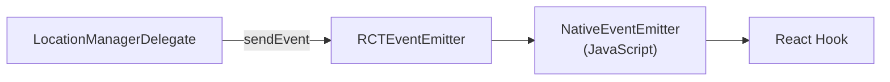
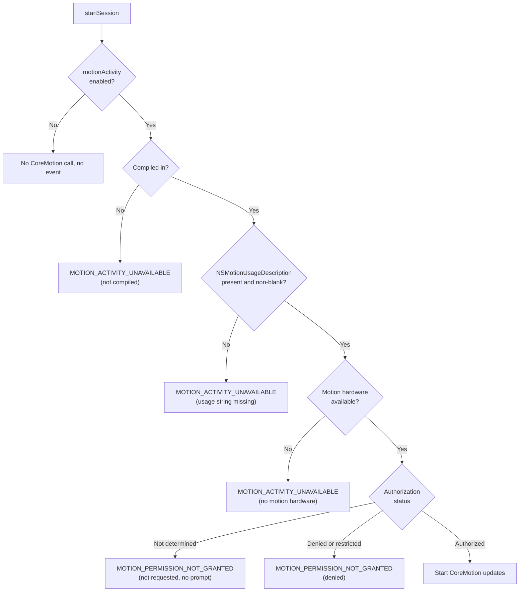

# iOS Native Architecture

All iOS native code lives under `ios/`. The implementation uses Swift for business logic with an Objective-C++ bridge file for TurboModule compatibility. Persistence uses Core Data with a SQLite store.

## Component Overview



## TurboModule Bridge

### BackgroundLocation.mm

The Objective-C++ bridge file connects the Codegen-generated spec to the Swift implementation. It uses `@objc` protocol conformance to forward all spec methods.



The bridge handles type conversion between React Native types (`ReadableMap`, `WritableMap`) and Swift types. All TurboModule spec methods are declared in this file and forwarded to Swift classes.

> This Objective-C++ bridge is necessary because React Native's TurboModule Codegen generates Objective-C++ code, and Swift classes cannot directly conform to the generated spec protocol.

## LocationManagerWrapper

The central orchestrator for all `CLLocationManager` operations. This is the iOS equivalent of Android's `LocationService` + `LocationProvider` combined.

### Configuration

When `startTracking()` is called, `LocationManagerWrapper` configures `CLLocationManager` with:

| Property | Source | Default |
|----------|--------|---------|
| `desiredAccuracy` | `TrackingOptions.accuracy` mapped via `LocationAccuracy` | `kCLLocationAccuracyBest` |
| `distanceFilter` | `TrackingOptions.distanceFilter` | `kCLDistanceFilterNone` |
| `allowsBackgroundLocationUpdates` | Always `true` | -- |
| `pausesLocationUpdatesAutomatically` | `TrackingOptions` | `false` |
| `activityType` | `TrackingOptions.activityType` mapped via `LocationActivityType.swift` | `CLActivityType.other` |
| `showsBackgroundLocationIndicator` | Always `true` | -- |

After the start, `applyLocationProfile` is the only writer of `desiredAccuracy` and `distanceFilter`. It runs on the wrapper's serial queue and sets both properties on the main thread, so successive profiles keep their order. The opt-in motion reduction uses it to switch between the trip's full profile (its accuracy and distance filter, as configured at start) and the reduced profile; see [Location Profiles](#location-profiles).

### Lifecycle



### Stop Token

Uses `UserDefaults` to store a boolean flag with a 60-second TTL, mirroring the Android SharedPreferences pattern. Checked before processing each location update in the delegate.

## LocationManagerDelegate

Implements `CLLocationManagerDelegate` to handle all callbacks from `CLLocationManager`.

### Location Updates



Each `CLLocation` is converted to the library's coordinate format with all available fields: latitude, longitude, timestamp, horizontal accuracy, altitude, speed, course (bearing), vertical accuracy, and floor level (when available).

### Error Handling

| Delegate Method | Event Emitted | Description |
|----------------|--------------|-------------|
| `didFailWithError:` | `onLocationError` | Location provider failure |
| `didChangeAuthorization:` (downgrade) | `onLocationWarning` | Permission downgraded while tracking (`PERMISSION_DOWNGRADED`) |
| `didChangeAuthorization:` (revoked) | `onLocationError` | Permission fully revoked while tracking (`PERMISSION_REVOKED`) |

While the opt-in motion reduction is active, a `didFailWithError:` other than `.denied` is not reported: it would describe the keep-alive request, not the trip. During the periodic full-accuracy probe the full profile runs and errors are reported normally.

### Authorization Monitoring

The delegate monitors `didChangeAuthorization:` while tracking is active. If the user revokes or downgrades location permission via Settings while the app is tracking, the delegate emits the appropriate error or warning event to JavaScript.

## Always Permission Escalation

iOS requires a two-step permission flow for "Always" location access. The library handles this transparently through `LocationManagerWrapper`.

### The Two-Step Flow



### The shouldIgnoreNextAuthCallback Guard

When `requestAlwaysAuthorization()` is called, iOS may immediately fire `didChangeAuthorization:` with the current (WhenInUse) status before the user has responded to the Always prompt. Without the guard, the completion handler would resolve prematurely with `WHEN_IN_USE` instead of waiting for the actual user decision.

The `shouldIgnoreNextAuthCallback` flag:

1. Is set to `true` immediately before calling `requestAlwaysAuthorization()`.
2. Causes the next `didChangeAuthorization:` callback to be ignored (resets the flag but does not resolve the completion handler).
3. The subsequent callback -- triggered by the actual user response -- resolves normally.



> This guard is necessary because iOS's delegate behavior when assigning a new delegate or calling `requestAlwaysAuthorization()` is to immediately fire `didChangeAuthorization:` with the current authorization status, which would resolve the pending promise before the user has made their choice.

## Core Data Persistence

### CoreDataStack

Sets up the Core Data environment:

- `NSPersistentContainer` with the library's `.xcdatamodeld` model.
- **Main context** for read operations on the main thread.
- **Background context** via `performBackgroundTask` for write operations.
- SQLite store for durable persistence.

### LocationStorage

Core Data persistence layer with batched async writes, mirroring the Android Room implementation.

| Feature | Implementation |
|---------|---------------|
| Batch writes | Array buffer, flushed at 10 items or 5-second timer |
| Force flush | `forceFlush()` drains buffer before reads |
| Tracking state | Core Data entity for crash recovery |
| Thread safety | `performBackgroundTask` for all writes |
| Read operations | Main context queries |
| Options extras | `UserDefaults` key `bg_location_tracking_options_ext` for the options Core Data has no attribute for; see [Crash Recovery Extras](#crash-recovery-extras) |

### Data Model

The Core Data model mirrors the Android Room schema:



## RecoveryManager

Handles crash recovery using iOS significant location monitoring -- a system-managed, low-power mechanism that relaunches the app when the device moves a significant distance (typically 500m+).

### Recovery Flow



### Rate Limiting

The recovery manager limits itself to **5 recoveries per hour** to prevent runaway recovery loops. The counter resets after 1 hour from the first recovery.

| Condition | Action |
|-----------|--------|
| Counter < 5, within 1 hour | Allow recovery, increment counter |
| Counter >= 5, within 1 hour | Skip recovery |
| Counter > 0, timestamp > 1 hour old | Reset counter, allow recovery |

### Significant Location Monitoring

When tracking starts, `LocationManagerWrapper` also calls `startMonitoringSignificantLocationChanges()`. This serves as the recovery trigger:

- **While app is running** -- Significant location changes are ignored (normal tracking is active).
- **After app termination** -- iOS relaunches the app in the background when a significant location change occurs, allowing `RecoveryManager` to restore the tracking session.

> Significant location monitoring is very low power. It uses cell tower transitions rather than GPS, so it does not significantly impact battery life.

## TrackingOptions Mapping

`TrackingOptions.swift` converts the bridge values into iOS-native equivalents:

| Bridge Field | iOS Property | Notes |
|-------------|-------------|-------|
| `accuracy` (string) | `CLLocationAccuracy` | Mapped via `LocationAccuracy.swift` |
| `activityType` (string) | `CLActivityType` | Mapped via `LocationActivityType.swift`. Defaults to `.other`. Unknown values fall back to `.other` and log a guard warning. |
| `distanceFilter` (number) | `CLLocationDistance` | `0` maps to `kCLDistanceFilterNone` |
| `updateInterval` | Not used | iOS does not support interval-based updates |
| `fastestInterval` | Not used | iOS does not support interval-based updates |
| `foregroundOnly` | `allowsBackgroundLocationUpdates` | Inverted: `foregroundOnly: true` sets background updates to `false` |
| `notificationOptions` | Not used | iOS does not show persistent notifications for location |
| `motionActivityEnabled`, `motionReduceWhenStationary`, `motionStationaryDelay`, `motionAutomotiveCooldown`, `motionMaxReducedDuration` | `MotionOptions` | Opt-in motion activity. `nil` (feature off) unless `motionActivityEnabled` is `true`; the durations get the defaults and clamps again. `motionSampleInterval` and `motionReducedNotificationText` are Android-only and not transported |

> iOS does not support time-based update intervals (`updateInterval`, `fastestInterval`). Location updates are delivered as fast as the hardware provides them, filtered only by `distanceFilter` and `desiredAccuracy`. Android-specific notification fields are silently ignored.

## LocationAccuracy Mapping

`LocationAccuracy.swift` maps the library's accuracy enum to `CLLocationAccuracy` constants:

| Library Value | iOS Constant | Approximate Accuracy |
|--------------|-------------|---------------------|
| `HIGH_ACCURACY` | `kCLLocationAccuracyBest` | ~5m |
| `BALANCED_POWER_ACCURACY` | `kCLLocationAccuracyHundredMeters` | ~100m |
| `LOW_POWER` | `kCLLocationAccuracyKilometer` | ~1km |
| `NO_POWER` / `PASSIVE` | `kCLLocationAccuracyThreeKilometers` | ~3km |

## Event Emission

Unlike Android's SharedFlow architecture, iOS emits events directly from the delegate to JavaScript via `RCTEventEmitter`.



The same five event names are emitted on both platforms:

| Event | Trigger |
|-------|---------|
| `onLocationUpdate` | `didUpdateLocations:` callback |
| `onLocationError` | `didFailWithError:` or permission revoked |
| `onLocationWarning` | Permission downgraded; motion activity warnings (opt-in) |
| `onNotificationAction` | Not applicable (iOS does not use persistent tracking notifications) |
| `onMotionActivity` | CoreMotion update forwarded by `MotionCoordinator` (opt-in) |

### addListener / removeListeners

The TurboModule spec requires `addListener(eventName:)` and `removeListeners(count:)` methods on iOS. These are called by `NativeEventEmitter` when JavaScript adds or removes event subscriptions. The implementation tracks listener count to avoid emitting events when no JavaScript listeners are active.

## Motion Activity

The opt-in motion activity feature lives in `ios/Motion/`. Its CoreMotion code is compiled in only when the app asks for it, and nothing in it runs unless a trip enables `motionActivity`. The [Motion Activity guide](../guides/motion-activity.md) describes the public behaviour.

### Compile-Time Opt-In

The podspec reads the Podfile global `$BackgroundLocationMotionActivity`:

```ruby
# BackgroundLocation.podspec
motion_activity = defined?($BackgroundLocationMotionActivity) && $BackgroundLocationMotionActivity == true
s.frameworks = motion_activity ? ["CoreLocation", "CoreData", "CoreMotion"] : ["CoreLocation", "CoreData"]
# Must be set before install_modules_dependencies(s), which merges and then reassigns pod_target_xcconfig.
s.pod_target_xcconfig = { "OTHER_SWIFT_FLAGS" => "$(inherited) -DBACKGROUND_LOCATION_MOTION" } if motion_activity
```

- **Flag on** -- The app's Podfile sets `$BackgroundLocationMotionActivity = true` before its first `target` (by hand, or through the Expo `motionActivity` plugin prop). The pod links `CoreMotion` and compiles with the Swift flag `-DBACKGROUND_LOCATION_MOTION`, and the app must declare `NSMotionUsageDescription`.
- **Flag off** (default) -- No CoreMotion code is compiled or linked, and the app needs no `NSMotionUsageDescription` because of this library. `MotionActivityPlatformFactory` provides no platform, so a trip with `motionActivity` enabled gets the "not compiled" warning and the permission functions resolve `unavailable`.

The xcconfig is assigned before `install_modules_dependencies(s)` because that call merges the value already set and reassigns `pod_target_xcconfig`. In that order, the motion flag and the flags React Native adds (such as `-DRCT_NEW_ARCH_ENABLED`) both survive.

### Source Files

| File | Imports | Role |
|------|---------|------|
| `MotionGate.swift` | Foundation | Pure reduction decision function, the same decision table as Android's `MotionGate.kt` (see [Reduction Gate](./data-flow.md#reduction-gate)) |
| `MotionNormalization.swift` | Foundation | Maps the `CMMotionActivity` flags, copied into plain values, to activity, confidence and gate input. Priority: automotive, cycling, running, walking, unknown, stationary |
| `MotionOptions.swift` | Foundation | Applies the defaults and clamps again to the transported durations |
| `MotionPreconditions.swift` | Foundation | Start-up checks in order, permission and detection status mapping, and the exact warning messages |
| `MotionCoordinator.swift` | Foundation, UIKit | Owns one motion session: activity source, gate, timers, permission re-checks and state snapshot |
| `CoreMotionActivitySource.swift` | CoreMotion (flag on only) | `CMMotionActivityManager` source and the permission request. All CoreMotion code is inside `#if BACKGROUND_LOCATION_MOTION`; the `#else` branch only provides a factory that reports "not compiled" |

The four Foundation-only files contain no `#if`, no `@objc` and no logging seam, so `yarn test:ios` compiles them unchanged for macOS (see [Testing](../development/testing.md)).

### MotionCoordinator

- **Queue confinement** -- Every method runs on the wrapper's serial queue; debug builds assert it with `dispatchPrecondition(condition: .onQueue(queue))`.
- **Generation token** -- Bumped on every session start and stop. Readings, timers and observers keep the token they were created with and drop their work when it is no longer current.
- **Start-up checks** -- `startSession(tripId:options:)` never prompts, and with the feature off it does nothing. Otherwise it runs the checks below. A failed check sets the detection status and queues one warning with `queue.async`, so the warning arrives just after `startTracking` resolves, and tracking continues at full accuracy.
- **Activity source** -- Created only after every check passed. CoreMotion delivers on its own serial `OperationQueue`, and each reading hops to the wrapper's queue.
- **Timers** -- `DispatchSourceTimer`s on the same serial queue: dwell, cooldown, maximum reduced period and the 120-second probe. The maximum-reduced-period and probe timers are scheduled with `wallDeadline` (`DispatchWallTime`), so a device sleep does not stretch the backstop. The dwell and cooldown timers use `deadline` (`DispatchTime`), whose clock does not advance while the device sleeps, so a sleep can only postpone a reduction.
- **Permission re-checks** -- `UIApplication.didBecomeActiveNotification` is observed only while detection runs, each maximum-reduced-period timer re-checks the authorization before probing, and a dwell or cooldown timer that fires while a stationary period is being confirmed re-checks it too. A revoked permission ends detection: the gate restores full accuracy first (`MOTION_LOCATION_RESTORED`, "Motion activity stopped; ...") and then "Motion activity permission was revoked" is reported.
- **Emission guard** -- Nothing is emitted once tracking has stopped or the stop token is set, and a session sends at most one detection warning (the first cause wins).



### Location Profiles

| Profile | `desiredAccuracy` | `distanceFilter` | Used |
|---------|-------------------|------------------|------|
| Full | The trip's accuracy, mapped via `LocationAccuracy` | The trip's `distanceFilter`, or the accuracy-based default | At start, on every restore and during the probe |
| Reduced | `kCLLocationAccuracyThreeKilometers` | 500 m | While the device is stationary (opt-in reduction) |

`applyLocationProfile` is the only writer of the two properties after the start. Standard location updates keep running and `allowsBackgroundLocationUpdates` is unchanged, so the app is not suspended and CoreMotion keeps delivering. While reduced, keep-alive fixes only feed the displacement check: they skip the 10-second age filter and are never persisted or emitted.

When the gate asks for the full profile, the queue marks the switch as pending at once, so fixes count as keep-alive fixes until it completes. The main thread applies the properties and stamps the time right after, then hands the stamp back to the queue; only fixes taken at or after that stamp count as full-accuracy fixes. A full-accuracy fix enters the gate with its horizontal accuracy plus the profile's distance filter.

### Warning Payloads

One helper, `makeWarningEvent(type:message:tripId:)`, builds every `onLocationWarning` payload, for the existing location warnings and the motion warnings alike: `type`, `message`, `tripId` when known, and `timestamp` (milliseconds since 1970, taken when the warning is emitted). Before 1.2.0 the field was declared in TypeScript but never sent.

### Bridge Methods

| `LocationManagerWrapper` member | Spec method or event | Behaviour |
|---|---|---|
| `checkMotionPermission()` | `checkMotionPermission()` | Never prompts. `unavailable` when not compiled in, when `NSMotionUsageDescription` is missing or blank, or without motion hardware; otherwise `granted`, `undetermined` or `denied` |
| `requestMotionPermission(completion:)` | `requestMotionPermission()` | Prompts (Motion & Fitness) only while access is undetermined, and only works with the app in the foreground; otherwise returns the current status. When the prompt's query completes, it re-reads the authorization status and maps it, whatever error CoreMotion reported: `granted`, `denied`, or `undetermined` when the user has not answered (for example, the app was not active). Independent of the location-permission flow |
| `motionActivityStateJSON()` | `getMotionActivityState()` | JSON snapshot read from `MotionCoordinator` with `queue.sync` |
| `onMotionActivity` | `onMotionActivity` event | Closure that `BackgroundLocation.mm` sets to emit the payload to JavaScript |

### Crash Recovery Extras

Core Data has no attributes for `activityType`, `waitForAccurateLocation` and the motion keys, and the model does not change. `LocationStorage` keeps them in `UserDefaults` under `bg_location_tracking_options_ext`, written while tracking is active and removed otherwise. `RecoveryManager` merges them into the recovered options and passes the result through the same sanitizing as `startTracking` (`TrackingOptions.from(rawOptions:methodName:)`): a wrong-typed value falls back to its default with one log line.

Crash recovery therefore restores `activityType` (previously reset to the default), `waitForAccurateLocation` and the motion options. Motion restarts through the normal path with a fresh reduction state: no prompt, full accuracy, cooldown first.

### Privacy Manifest

The library's `ios/PrivacyInfo.xcprivacy` is unchanged: CoreMotion has no required-reason API category, and the library never transmits motion data. If the host app uploads or shares motion-derived data, it declares that itself, in its App Store privacy details and its own privacy manifest (for example, Fitness).

## Platform Differences from Android

| Aspect | Android | iOS |
|--------|---------|-----|
| Background execution | Foreground Service (persistent notification) | CLLocationManager background mode (blue status bar indicator) |
| Update intervals | Configurable (`updateInterval`, `fastestInterval`) | Not supported (hardware-driven) |
| Notification | Required (foreground service) | Not applicable |
| Notification actions | Up to 3 action buttons | Not applicable |
| Location provider | Dual (Fused + Android fallback) | CLLocationManager only |
| Event architecture | SharedFlow singletons + coroutine collection | Direct delegate-to-RCTEventEmitter |
| Recovery mechanism | WorkManager (CoroutineWorker) | Significant location monitoring |
| Recovery rate limit | 5 restarts/hour (restart loop detection) | 5 recoveries/hour (rate limiting) |
| Persistence | Room (SQLite) | Core Data (SQLite) |
| Geofence limit | 100 (Google Play Services) | 20 (CLLocationManager) |
| Permission flow | Sequential prompts via PermissionsAndroid | Two-step WhenInUse-to-Always escalation |
| Motion activity source (opt-in) | Activity Recognition API (Google Play services), always compiled | CoreMotion, compiled in only with the Podfile flag |
| Motion sampling | Samples every `sampleInterval`, plus transitions | Every CoreMotion update (`sampleInterval` is ignored) |
| Reduced profile | `PRIORITY_LOW_POWER`, 60 s interval, 30 s fastest interval, no distance filter | `kCLLocationAccuracyThreeKilometers`, 500 m distance filter |
| Reduction timers | Inexact `setAndAllowWhileIdle` alarms (up to about 75% late, later in Doze) | `DispatchSourceTimer`s on the serial queue (maximum reduced period and probe on wall-clock time) |

## Next Steps

- [Android Native Architecture](./android-native.md) -- The Android counterpart using Kotlin, Coroutines, and Room.
- [Data Flow](./data-flow.md) -- Cross-platform data flow comparison.
- [Architecture Overview](./overview.md) -- High-level three-layer design and key decisions.
- [Motion Activity](../guides/motion-activity.md) -- Setup and behaviour of the opt-in motion activity feature.
