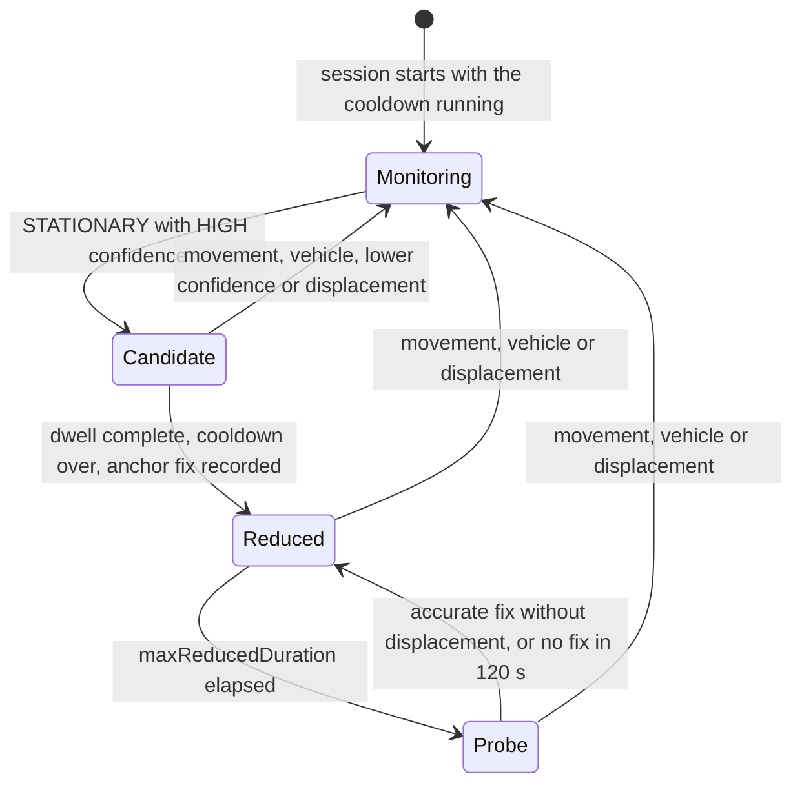

# Motion Activity

Motion activity is an opt-in extension of a tracking session. It has two parts:

1. **Detection** — the session reports what the device is doing (`STATIONARY`, `WALKING`, `RUNNING`, `CYCLING`, `AUTOMOTIVE` or `UNKNOWN`) as `onMotionActivity` events.
2. **Reduction (optional)** — while the device is confirmed stationary, location updates are degraded to a low-power keep-alive request and restored on the first sign of movement.

Both are **off by default**. Without the `motionActivity` tracking option the library behaves exactly as before: it creates no activity recognition client (on Android, except to remove a registration left by an earlier session), makes no CoreMotion call, never checks or requests the motion permission, and emits no `onMotionActivity` event or `MOTION_*` warning.

> **Note:** Motion activity is available from version 1.2.0.

## Overview

|                       | Android                                                                       | iOS                                                                       |
| --------------------- | ----------------------------------------------------------------------------- | ------------------------------------------------------------------------- |
| Detection engine      | Activity Recognition API (Google Play services)                               | CoreMotion `CMMotionActivityManager`                                      |
| Delivery              | Activity transitions, plus a sample every `sampleInterval` (30 s by default)  | Every activity update, as it happens                                      |
| Permission            | `ACTIVITY_RECOGNITION` (runtime on Android 10+), declared by your app         | Motion & Fitness, with `NSMotionUsageDescription`                          |
| Build requirement     | Two permissions in the app manifest (the library declares none)               | Podfile flag `$BackgroundLocationMotionActivity = true`, then `pod install` |
| Reduced profile       | `PRIORITY_LOW_POWER`, 60 s interval                                           | 3 km accuracy, 500 m distance filter                                      |
| Not available when    | Google Play services is missing                                               | The flag is off, the usage string is missing, or there is no motion hardware |

The API:

| Symbol                                                              | Purpose                                                       |
| ------------------------------------------------------------------- | ------------------------------------------------------------- |
| `TrackingOptions.motionActivity`                                    | Enables detection (and, optionally, the reduction)            |
| [`useMotionActivity`](../api-reference/hooks/useMotionActivity.md)  | Hook: last event, detection and reduction status              |
| `addMotionActivityListener(listener)`                               | Subscribes to `onMotionActivity` outside React                |
| `checkMotionPermission()` / `requestMotionPermission()`             | Motion permission status and prompt                           |
| `getMotionActivityState()`                                          | Snapshot of the current session                               |

See [Motion Activity Functions](../api-reference/functions.md#motion-activity-functions) and [Motion Activity Types](../api-reference/types.md#motion-activity-types) for the full reference.

## Setup

Each platform needs a one-time setup. Apps that do not use motion activity skip this section entirely.

### Android setup

The library manifest declares **no** activity recognition permission, so apps that do not use the feature never request it. Add both permissions to your app's `android/app/src/main/AndroidManifest.xml`:

```xml
<!-- Runtime permission on Android 10 (API 29) and later -->
<uses-permission android:name="android.permission.ACTIVITY_RECOGNITION" />
<!-- Granted at install time on Android 9 (API 28) and earlier -->
<uses-permission
    android:name="com.google.android.gms.permission.ACTIVITY_RECOGNITION"
    android:maxSdkVersion="28" />
```

Motion activity uses the Activity Recognition API of Google Play services. On devices without Google Play services, detection is unavailable: the session emits `MOTION_ACTIVITY_UNAVAILABLE` and keeps tracking at full accuracy. There is no fallback detector.

The library adds one component to the merged manifest: a non-exported receiver, `com.backgroundlocation.motion.MotionActivityReceiver`, that receives activity results and the reduction timers. It has no intent filter and needs no permission.

> **Important:** Google Play treats `ACTIVITY_RECOGNITION` as health-related sensitive data. Before `requestMotionPermission()`, show a prominent in-app disclosure and request the permission only after the user accepts; complete the Health apps declaration in Play Console; and declare motion-derived data that leaves the device in the Data safety form under Health and fitness > Fitness info. See [Google Play Compliance](../production/google-play-compliance.md#motion-activity-optional).

### iOS setup

The CoreMotion code is compiled into the library **only when your app opts in**. Set the flag before the first `target` in `ios/Podfile`:

```ruby
$BackgroundLocationMotionActivity = true

target 'YourApp' do
  # ...
end
```

Then reinstall the pods (run `pod install` again whenever you change the flag, also when you remove it):

```bash
cd ios && pod install
```

With the flag on, `BackgroundLocation.podspec` links the `CoreMotion` framework and compiles the motion sources (Swift flag `-DBACKGROUND_LOCATION_MOTION`). Add the purpose string shown in the Motion & Fitness prompt to `Info.plist`:

```xml
<key>NSMotionUsageDescription</key>
<string>We detect when your vehicle is parked to save battery during trips.</string>
```

Without the flag the library contains no CoreMotion code and your app needs no `NSMotionUsageDescription` because of this library. If JavaScript enables `motionActivity` in such a build, the session emits `MOTION_ACTIVITY_UNAVAILABLE` ("Motion activity is not compiled into this app...") and the permission functions resolve `UNAVAILABLE`.

> **Note:** The library's privacy manifest (`PrivacyInfo.xcprivacy`) is the same with and without the flag: CoreMotion has no required-reason API category, and the library never sends motion data anywhere. If your app uploads or shares motion-derived data (for example the activity events), declare it in your own App Store privacy details and privacy manifest. See [App Store Compliance](../production/app-store-compliance.md).

### Expo setup

Add the `motionActivity` prop to the config plugin. Its presence, even as `{}`, opts in:

```json
{
  "expo": {
    "plugins": [
      [
        "@gabriel-sisjr/react-native-background-location",
        {
          "motionActivity": {
            "usageDescription": "We detect when your vehicle is parked to save battery during trips."
          }
        }
      ]
    ]
  }
}
```

On `expo prebuild` the prop adds both Android permissions (the Play services entry with `android:maxSdkVersion="28"`), writes `NSMotionUsageDescription` (your `usageDescription`, then a value already in `ios.infoPlist`, then a generic default) and inserts `$BackgroundLocationMotionActivity = true` into the Podfile before the first target. To remove the feature later, delete the prop and run `npx expo prebuild --clean`: an incremental prebuild keeps the permissions, the usage string and the Podfile line the prop added. See the [Expo Config Plugin guide](./expo-config-plugin.md) for the details.

## Requesting the permission

`startTracking` never prompts for the motion permission, and a permission granted during a trip takes effect at the next `startTracking`. Request it before starting a trip, after the location permissions (`useLocationPermissions` does not cover it).

> **Important:** On Google Play, show a prominent disclosure of what is detected, why, and whether it leaves the device, and call `requestMotionPermission()` only after the user accepts it. Google Play treats `ACTIVITY_RECOGNITION` as health-related sensitive data; see [Prominent Disclosure and Consent](../production/google-play-compliance.md#prominent-disclosure-and-consent) for a sample disclosure.

| Status         | Android                                                                                  | iOS                                                                                                   |
| -------------- | ---------------------------------------------------------------------------------------- | ----------------------------------------------------------------------------------------------------- |
| `GRANTED`      | Permission granted                                                                       | Motion & Fitness authorized                                                                           |
| `DENIED`       | Not granted (also after "Don't ask again")                                               | Denied or restricted                                                                                  |
| `UNDETERMINED` | Never returned                                                                           | Not asked yet, or not answered (for example, requested while the app was not active)                  |
| `UNAVAILABLE`  | Google Play services is missing                                                          | Flag off, `NSMotionUsageDescription` missing or blank, or no motion hardware                         |

- `checkMotionPermission()` never prompts. On Android it checks `ACTIVITY_RECOGNITION` on API 29+ and the Play services permission on API 28 and lower.
- `requestMotionPermission()` on Android shows the system dialog on API 29+ when the permission is not granted. On API 28 and lower it returns the current status, because the permission is granted at install time when declared.
- `requestMotionPermission()` on iOS shows the Motion & Fitness prompt only while the status is undetermined, and only with the app in the foreground. When the user has not answered (for example, it was called while the app was not active), it resolves `UNDETERMINED`, so call it with the app in the foreground, from a user action.

```tsx
import { Linking } from 'react-native';
import {
  MotionPermissionStatus,
  requestMotionPermission,
  startTracking,
} from '@gabriel-sisjr/react-native-background-location';

async function startTripWithMotion(tripId: string) {
  // Location permissions first (see useLocationPermissions). Then your motion
  // disclosure (Google Play): showMotionDisclosure() is your own screen that
  // resolves true when the user accepts, as in Google Play Compliance.
  const accepted = await showMotionDisclosure();
  if (!accepted) {
    return startTracking(tripId); // full accuracy, no motion activity
  }

  const motion = await requestMotionPermission();

  if (motion === MotionPermissionStatus.DENIED) {
    // Tracking still works; offer the settings screen for next time
    Linking.openSettings();
  }

  // Without the permission the session warns once and tracks at full accuracy
  return startTracking(tripId, {
    motionActivity: { reduceWhenStationary: true },
  });
}
```

See [Permission Handling](./permission-handling.md) for the complete flow.

## Detecting motion activity

Enable detection with `motionActivity: true` (or an options object) and observe the events with the hook:

```tsx
import { Text } from 'react-native';
import {
  startTracking,
  useMotionActivity,
} from '@gabriel-sisjr/react-native-background-location';

async function startTrip() {
  await startTracking('trip-42', { motionActivity: true });
}

function MotionBadge() {
  const { lastActivity, detection } = useMotionActivity({ tripId: 'trip-42' });

  return (
    <Text>
      {detection}: {lastActivity?.activity ?? 'waiting'}
    </Text>
  );
}
```

Outside React, use the listener:

```ts
import { addMotionActivityListener } from '@gabriel-sisjr/react-native-background-location';

const subscription = addMotionActivityListener((event) => {
  console.log(event.tripId, event.activity, event.confidence, event.timestamp);
});

// Later
subscription.remove();
```

### The event

| Field        | Type                 | Description                                         |
| ------------ | -------------------- | --------------------------------------------------- |
| `tripId`     | `string`             | Trip of the session                                 |
| `activity`   | `MotionActivityType` | Normalized activity                                 |
| `confidence` | `MotionConfidence`   | `LOW`, `MEDIUM` or `HIGH`                           |
| `timestamp`  | `number`             | Time of the detection, in milliseconds since epoch  |

- Events are emitted only while a session with `motionActivity` enabled is running, and never after `stopTracking()`.
- Consecutive events of a session never repeat the same `activity` and `confidence` pair. The first event of each session is always emitted.
- Android emits periodic samples (every `sampleInterval`, 30 s by default, clamped to 10 s–5 min) and transitions into an activity. Transitions out of an activity are used internally and never emitted. `sampleInterval` is ignored on iOS, where CoreMotion reports every update as it happens.

### Normalization

Both platforms are mapped to the same `MotionActivityType` values:

| Activity     | Android                                                        | iOS `CMMotionActivity`                         |
| ------------ | -------------------------------------------------------------- | ---------------------------------------------- |
| `AUTOMOTIVE` | `IN_VEHICLE`                                                   | `automotive`                                   |
| `CYCLING`    | `ON_BICYCLE`                                                   | `cycling`                                      |
| `RUNNING`    | `RUNNING`, or `ON_FOOT` when running is the more probable      | `running`                                      |
| `WALKING`    | `WALKING`, or `ON_FOOT` otherwise                              | `walking`                                      |
| `UNKNOWN`    | `UNKNOWN`, `TILTING`                                           | `unknown`, or no flag set                      |
| `STATIONARY` | `STILL`                                                        | `stationary`, only when no other flag is set   |

On iOS several flags can be set at once. The priority is automotive, cycling, running, walking, unknown, stationary, so a car waiting at a red light (automotive and stationary) is reported as `AUTOMOTIVE`.

Confidence: Android buckets the 0–100 confidence of the most probable activity (75 and above is `HIGH`, 50 to 74 is `MEDIUM`, below 50 is `LOW`) and reports transitions as `HIGH`; iOS maps CoreMotion's own confidence.

### The state snapshot

`getMotionActivityState()` and the hook expose the state of the current session:

| `detection`              | Meaning                                                              |
| ------------------------ | -------------------------------------------------------------------- |
| `OFF`                    | No session, or the session did not enable `motionActivity`           |
| `RUNNING`                | Events are being delivered                                           |
| `UNAVAILABLE`            | Detection could not start or was lost                                |
| `PERMISSION_NOT_GRANTED` | The motion permission is missing or was revoked                      |

The `reduction` values are described in [How the reduction works](#how-the-reduction-works).

The hook reads this snapshot by itself on mount, when the app becomes active, on every `MOTION_*` warning and on the first event of a new session. A stop emits nothing, so call its `refresh()` after `stopTracking()`; see [After `startTracking()` and `stopTracking()`](../api-reference/hooks/useMotionActivity.md#after-starttracking-and-stoptracking).

## Reducing location updates while stationary

Add `reduceWhenStationary` to save battery while a vehicle or device is parked:

```ts
await startTracking('trip-42', {
  motionActivity: { reduceWhenStationary: true },
});
```

The reduction is a **degrade, never a stop**: a low-power request keeps running, the Android foreground service stays up, and the iOS app is not suspended. It applies only when all of these hold:

- detection is running (permission granted, Google Play services or CoreMotion available);
- the trip is not `foregroundOnly`;
- the accuracy is not `PASSIVE` or `NO_POWER` (those modes are already low power).

Otherwise the session tracks at full accuracy and `reduction` reports `NOT_APPLICABLE` (silently), `DISABLED` or `UNAVAILABLE`. Activity events keep flowing whenever detection runs.

### How the reduction works



`reduction` reports `MONITORING` during Monitoring and Candidate, and `REDUCED` during Reduced and Probe.

1. **Every session starts at full accuracy** with the automotive cooldown running, as if a vehicle had just been seen. No reduction happens during the first `automotiveCooldown` of a session (10 minutes by default). This applies to `startTracking`, crash recovery and service restarts alike: the reduction state is never persisted.
2. **Candidate.** A `STATIONARY` event with `HIGH` confidence (on Android, also a transition into `STILL`) starts a dwell of `stationaryDelay` (5 minutes by default). The anchor is the last recorded full-accuracy fix. Silence from the classifier does not break the dwell.
3. **The dwell breaks** on `STATIONARY` with `MEDIUM` confidence, on any movement (`WALKING`, `RUNNING`, `CYCLING`, `UNKNOWN`, `STATIONARY` with `LOW` confidence, or an Android transition out of `STILL`), on any vehicle evidence, and on a recorded fix that moved away from the anchor (by the distance rule in step 6).
4. **Reduce** when the dwell is complete, no vehicle evidence was seen within `automotiveCooldown`, and an anchor fix exists. The buffered locations are written to storage, the reduced profile is applied and `MOTION_LOCATION_REDUCED` is emitted.
5. **While reduced**, the keep-alive fixes are never stored or emitted: they only feed the displacement check. `LOCATION_UNAVAILABLE` is not reported either, because it would describe the keep-alive request rather than the trip. During the probe (step 7) the full profile runs and location errors are reported normally.
6. **Restore** full accuracy (and emit `MOTION_LOCATION_RESTORED`) on:
   - movement or vehicle evidence at any confidence;
   - a keep-alive fix that moved: its distance from the anchor exceeds both 100 m and the sum of the two fixes' accuracies, so their error circles no longer overlap. A full-accuracy fix, such as the anchor, counts with its accuracy plus the distance filter the trip runs with, because with a distance filter the last recorded fix can be up to that far from where the device stopped; a keep-alive fix counts with its own accuracy. With a 150 m distance filter and an anchor accuracy of 10 m, for example, a keep-alive fix with 30 m accuracy must be more than 190 m from the anchor;
   - detection stopping (for example the permission was revoked);
   - on Android, a restart of the foreground service in the same process, such as the Android 15+ foreground-service timeout restart.

   After a restore, fixes taken before the full profile was back are discarded as keep-alive fixes. A second `startTracking` while a trip is running returns the running trip and changes nothing. After the process is killed, the recovered session starts at full accuracy without a warning.
7. **Probe.** Every `maxReducedDuration` (30 minutes by default) the full profile is applied for up to 120 seconds. A fix with an accuracy of 100 m or better that has not moved is recorded, and the reduction continues silently. Movement or displacement restores full accuracy as above. If no fix arrives within 120 seconds, the reduction continues silently. JavaScript keeps seeing `REDUCED` throughout.

| Profile                 | Android                                                                         | iOS                                                                                          |
| ----------------------- | ------------------------------------------------------------------------------- | -------------------------------------------------------------------------------------------- |
| Reduced                 | Fused provider at `PRIORITY_LOW_POWER`, 60 s interval, 30 s fastest interval, no distance filter | `kCLLocationAccuracyThreeKilometers`, `distanceFilter` 500 m; updates keep running, background updates stay allowed |
| Full (restore, probe)   | The trip's own accuracy, interval and distance filter                           | The trip's own accuracy and distance filter                                                  |
| Timers                  | Inexact allow-while-idle alarms (no exact-alarm permission): up to about 75% late, later in Doze | Timers on the library's serial queue; the maximum-duration and probe timers follow wall-clock time |

> **Android timers:** the dwell, cooldown, maximum-duration and probe timers use `AlarmManager.setAndAllowWhileIdle`, so no exact-alarm permission is required or added. These alarms are inexact. Outside Doze and battery saver, the system can deliver each one up to about 75% of its duration later than configured: with the defaults, the stationary delay can take up to about 8.75 minutes, the cooldown about 17.5 minutes, the maximum reduced duration about 52.5 minutes and the probe about 3.5 minutes. Android 12 and later deliver an inexact alarm within one hour of its time unless battery saver or Doze is active. In Doze the alarms come later still: allow-while-idle alarms fire at most once every 9 minutes per app. The motion classifier (transitions and samples) remains the primary way back to full accuracy. If Android refuses to schedule one of these timers, the session stops motion detection and continues at full accuracy, with one `MOTION_ACTIVITY_UNAVAILABLE` warning (see [Warnings](#warnings)).
>
> **iOS timers:** the maximum-duration and probe timers follow wall-clock time: time the device spends asleep counts toward them, so a sleep does not stretch the interval between forced fixes. The dwell and cooldown timers count only the time the device is awake, so a sleep can postpone a reduction, never a restore.

On Android, the foreground service keeps running while reduced (`LocationService.isRunning` does not change), so crash recovery and the restart protection behave as during full-accuracy tracking.

### Options

| Option                                    | Type      | Default                                       | Range (clamped)      | Platform     |
| ----------------------------------------- | --------- | --------------------------------------------- | -------------------- | ------------ |
| `motionActivity.sampleInterval`           | `number`  | `30000` (30 s)                                | 10000 – 300000       | Android      |
| `motionActivity.reduceWhenStationary`     | `boolean \| MotionReductionOptions` | off                  | —                    | Android, iOS |
| `reduceWhenStationary.stationaryDelay`    | `number`  | `300000` (5 min)                              | 60000 – 3600000      | Android, iOS |
| `reduceWhenStationary.automotiveCooldown` | `number`  | `600000` (10 min)                             | 120000 – 3600000     | Android, iOS |
| `reduceWhenStationary.maxReducedDuration` | `number`  | `1800000` (30 min)                            | 300000 – 3600000     | Android, iOS |
| `reduceWhenStationary.notificationText`   | `string`  | `'Location updates reduced while stationary'` | non-blank            | Android      |

Durations are in milliseconds. `reduceWhenStationary: true` uses every default.

- Out-of-range numbers are clamped to the range and rounded to whole milliseconds, in JavaScript and again in the native code.
- Malformed values never reach the native code. In development builds (`__DEV__`) each one logs a single `[BackgroundLocation]` warning per JavaScript session:
  - a malformed `sampleInterval` falls back to the default and detection stays on;
  - a malformed `stationaryDelay`, `automotiveCooldown` or `maxReducedDuration`, or a `reduceWhenStationary` that is neither a boolean nor an object, turns the reduction off (continuous full accuracy) while detection stays on;
  - a `motionActivity` value that is neither a boolean nor an object turns the feature off;
  - a blank `notificationText` is ignored silently.

### Android notification text

While updates are reduced, the content text of the foreground notification switches to `notificationText`. The title, icon, actions and channel do not change, and the base text returns when full accuracy is restored. If you call `updateNotification(title, text)` while reduced, the title changes at once and the new text is shown when full accuracy returns.

The default text is English (`'Location updates reduced while stationary'`). Apps in other languages should set it together with their own notification texts:

```ts
await startTracking('trip-42', {
  notificationOptions: {
    title: 'Viagem em andamento',
    text: 'Registrando sua localização',
  },
  motionActivity: {
    reduceWhenStationary: {
      notificationText: 'Atualizações reduzidas enquanto o veículo está parado',
    },
  },
});
```

iOS has no foreground notification, so `notificationText` is ignored there.

## Warnings

Motion warnings arrive on `onLocationWarning` like every other warning, as `{ type, message, tripId, timestamp }`, with the active trip ID. `startTracking` never throws or rejects because of motion activity.

**Detection warnings.** At most one per session: the first cause wins, and tracking continues at full accuracy.

| Type                            | Platform | Message                                                                                                                                                                                                 |
| ------------------------------- | -------- | ------------------------------------------------------------------------------------------------------------------------------------------------------------------------------------------------------- |
| `MOTION_ACTIVITY_UNAVAILABLE`   | Android  | `Motion activity needs Google Play services, which is not available. Location tracking continues at full accuracy.`                                                                                     |
| `MOTION_ACTIVITY_UNAVAILABLE`   | Android  | `Motion activity could not start (<detail>). Location tracking continues at full accuracy.` — `<detail>` is `status <code>` or the exception name, or `AlarmManager` when a reduction timer cannot be scheduled |
| `MOTION_PERMISSION_NOT_GRANTED` | Android  | `ACTIVITY_RECOGNITION permission is not granted. Call requestMotionPermission() before startTracking(). Location tracking continues at full accuracy.`                                                 |
| `MOTION_PERMISSION_NOT_GRANTED` | Android  | `com.google.android.gms.permission.ACTIVITY_RECOGNITION is not declared in AndroidManifest.xml. Location tracking continues at full accuracy.` (Android 9 and earlier)                                  |
| `MOTION_PERMISSION_NOT_GRANTED` | Android  | `Motion activity permission was revoked. Location tracking continues at full accuracy.`                                                                                                                 |
| `MOTION_ACTIVITY_UNAVAILABLE`   | iOS      | `Motion activity is not compiled into this app. Set $BackgroundLocationMotionActivity = true in the Podfile (or add the motionActivity plugin prop) and reinstall pods. Location tracking continues at full accuracy.` |
| `MOTION_ACTIVITY_UNAVAILABLE`   | iOS      | `NSMotionUsageDescription is missing from Info.plist. Location tracking continues at full accuracy.`                                                                                                    |
| `MOTION_ACTIVITY_UNAVAILABLE`   | iOS      | `Motion activity is not available on this device. Location tracking continues at full accuracy.`                                                                                                        |
| `MOTION_PERMISSION_NOT_GRANTED` | iOS      | `Motion & Fitness permission has not been requested. Call requestMotionPermission() before startTracking(). Location tracking continues at full accuracy.`                                             |
| `MOTION_PERMISSION_NOT_GRANTED` | iOS      | `Motion & Fitness permission is denied. Location tracking continues at full accuracy.`                                                                                                                  |
| `MOTION_PERMISSION_NOT_GRANTED` | iOS      | `Motion activity permission was revoked. Location tracking continues at full accuracy.`                                                                                                                 |

iOS checks, in order: the compile flag, the usage string, the motion hardware, then the authorization. Its detection warnings arrive just after `startTracking` resolves. The permission is checked again when the app becomes active, at each `maxReducedDuration` timer, and when the stationary-delay or cooldown timer fires while a stationary period is being confirmed, which is how a revocation during a trip is noticed. On Android, revoking the permission in Settings ends the app process; when tracking restarts (for example through crash recovery), the new session reports the missing permission.

On Android, a reduction timer that cannot be scheduled ends motion detection for the session as if it had been lost: full accuracy returns (with `MOTION_LOCATION_RESTORED` first if updates were reduced), `detection` becomes `UNAVAILABLE`, and the session emits `MOTION_ACTIVITY_UNAVAILABLE` with `Motion activity could not start (AlarmManager). Location tracking continues at full accuracy.`

**Reduction warnings.** Exactly one per visible transition, never after `stopTracking()`:

| Type                       | When                                   | Message                                                                                    |
| -------------------------- | -------------------------------------- | ------------------------------------------------------------------------------------------ |
| `MOTION_LOCATION_REDUCED`  | Stationary period confirmed            | `Device stationary; location updates reduced to save battery.`                            |
| `MOTION_LOCATION_RESTORED` | Movement or vehicle detected           | `Movement detected; full-accuracy location updates restored.`                             |
| `MOTION_LOCATION_RESTORED` | Displacement while reduced             | `Device moved while updates were reduced; full-accuracy location updates restored.`       |
| `MOTION_LOCATION_RESTORED` | Detection stopped while reduced        | `Motion activity stopped; full-accuracy location updates restored.`                       |
| `MOTION_LOCATION_RESTORED` | Service restarted while reduced (Android) | `Tracking restarted; full-accuracy location updates restored.`                         |

If detection is lost while reduced, `MOTION_LOCATION_RESTORED` comes first, followed by the cause (for example `Motion activity permission was revoked...`). The periodic probe emits nothing. The reduction never emits `LOCATION_UPDATES_PAUSED` or `LOCATION_UPDATES_RESUMED`, which keep describing the iOS system pause.

```tsx
import { useLocationUpdates } from '@gabriel-sisjr/react-native-background-location';

function TripMonitor({ tripId }: { tripId: string }) {
  useLocationUpdates({
    tripId,
    onLocationWarning: (warning) => {
      switch (warning.type) {
        case 'MOTION_LOCATION_REDUCED':
        case 'MOTION_LOCATION_RESTORED':
          console.log(warning.type, new Date(warning.timestamp), warning.message);
          break;
        case 'MOTION_PERMISSION_NOT_GRANTED':
        case 'MOTION_ACTIVITY_UNAVAILABLE':
          // Tracking continues at full accuracy; surface the cause
          console.warn(warning.message);
          break;
        default:
          // LocationWarningType can gain members in minor releases
          break;
      }
    },
  });

  return null;
}
```

## Risk profile

Read this section before enabling the reduction in production.

| You gain                                                                 | You give up                                                                                                       |
| ------------------------------------------------------------------------ | ----------------------------------------------------------------------------------------------------------------- |
| Less GPS use while the device is parked                                   | Recorded fixes while parked: only one forced fix per `maxReducedDuration`                                         |
| A tracking session that stays alive through long stops                    | A restore delay when movement starts: the first metres of a departure can be missing or less accurate             |
| Warnings that mark every reduced period in your data                     | Geofence detection while reduced can be slower on Android (see below)                                             |

The battery saving depends on the device, the GPS environment and how long devices stay parked. Measure it on your own fleet; the [device test plan](../development/testing.md) includes a two-hour parked comparison.

**How full accuracy comes back**, in order of importance:

| Restore path            | How fast                                                                                                  | Notes                                                                                                                               |
| ----------------------- | --------------------------------------------------------------------------------------------------------- | ----------------------------------------------------------------------------------------------------------------------------------- |
| Motion classifier       | iOS: as CoreMotion reports the change. Android: on the next transition or sample (every `sampleInterval`) | The primary path. Any movement or vehicle evidence restores, whatever its confidence                                                |
| Displacement            | On the next keep-alive fix that has moved                                                                 | A coarse safety net: a keep-alive fix must be farther from the anchor than the sum of both accuracies (at least 100 m), and the anchor's accuracy includes the trip's distance filter. On iOS that is roughly the anchor's accuracy plus 1–3 km with the 3 km setting (less when iOS supplies Wi-Fi-based fixes), and the 500 m distance filter holds deliveries back until iOS estimates about 500 m of movement; Android low-power fixes are of a similar order. A short move goes unnoticed |
| Forced probe            | Every `maxReducedDuration`                                                                                | Bounds the time without a recorded fix. On Android the alarm is inexact: up to about 75% late, and later in Doze. On iOS it follows wall-clock time |
| Detection lost, restart | Immediately                                                                                               | Permission revoked, Google Play services failure, an Android reduction timer that cannot be scheduled, Android service restart. A session recovered after a process kill always starts at full accuracy |

**When the reduction never happens:**

- During the first `automotiveCooldown` of every session. With the defaults, the earliest reduction is 10 minutes after `startTracking`.
- At red lights and in stop-and-go traffic. Every vehicle evidence (iOS automotive flag; Android in-vehicle activity, or in-vehicle among the probable activities with a confidence of 50 or more) restarts the cooldown, and the dwell also needs 5 continuous minutes of high-confidence `STATIONARY`. With the defaults, a parked vehicle is reduced about 10 minutes after the last vehicle evidence (on Android up to about 17.5 minutes, because the timers are inexact).
- On `foregroundOnly` trips and with `PASSIVE` or `NO_POWER` accuracy (`reduction` is `NOT_APPLICABLE`).
- When detection is not running (`reduction` is `UNAVAILABLE`), or before the session has recorded a full-accuracy fix to anchor to.

### Geofencing while reduced

The reduction does not change geofence registrations.

- **Android:** the library's geofence location heartbeat runs only while tracking is not active, so it stays off while a trip is reduced. With only the low-power request alive, geofence transitions can be reported later than during full-accuracy tracking, until movement restores full accuracy. Since a parked device crosses no geofence, the delay mainly affects the first geofence after a departure.
- **iOS:** region monitoring is run by the system and is not changed by the reduction.

### Recommended settings

For fleets, the **defaults are the recommended settings**: `motionActivity: { reduceWhenStationary: true }`. Each option trades battery against data:

| Option               | Raise it to                                                     | Lower it to                                                                       |
| -------------------- | --------------------------------------------------------------- | --------------------------------------------------------------------------------- |
| `stationaryDelay`    | Avoid reductions during short stops (deliveries, queues)        | Reduce sooner after parking                                                       |
| `automotiveCooldown` | Be more conservative in traffic and after parking               | Reduce sooner after a drive (more risk of reducing in slow traffic)               |
| `maxReducedDuration` | Spend less battery on probes                                    | Record a fix more often while parked                                              |

Keep reduction off for trips that must record every fix (for example evidence trails), and always handle the `MOTION_*` warnings so reduced periods are visible in your data.

## Platform differences

| Topic                            | Android                                                                                   | iOS                                                                                  |
| -------------------------------- | ----------------------------------------------------------------------------------------- | ------------------------------------------------------------------------------------ |
| Detection requirement            | Google Play services                                                                      | Podfile flag, `NSMotionUsageDescription`, motion hardware                            |
| Permission prompt                | `PermissionsAndroid` dialog on API 29+; install-time on API 28 and lower                  | Motion & Fitness prompt, app in the foreground                                       |
| `UNDETERMINED` status            | Never                                                                                     | Until the user answers the prompt (request it in the foreground)                     |
| Sampling                         | `sampleInterval` plus transitions                                                         | Every CoreMotion update                                                              |
| Reduced profile                  | `PRIORITY_LOW_POWER`, 60 s                                                                | 3 km accuracy, 500 m distance filter                                                 |
| Timers                           | Inexact: up to about 75% late, later in Doze; a timer that cannot be scheduled ends detection for the session | Maximum-duration and probe timers follow wall-clock time; dwell and cooldown can run longer while the device sleeps |
| Notification while reduced       | `notificationText`                                                                        | None                                                                                 |
| Revocation during a trip         | The system ends the process; the next session reports it                                  | Noticed when the app becomes active, at the next `maxReducedDuration` timer, or when a timer fires while a stationary period is being confirmed |

## Next Steps

- [`useMotionActivity`](../api-reference/hooks/useMotionActivity.md) -- hook reference
- [Battery Optimization](./battery-optimization.md) -- other ways to save battery
- [Real-Time Updates](./real-time-updates.md) -- handling `onLocationWarning`
- [Troubleshooting](../troubleshooting.md) -- motion activity problems and fixes
